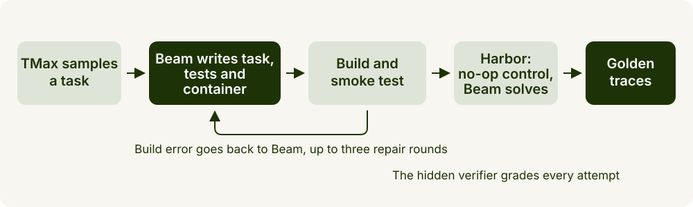
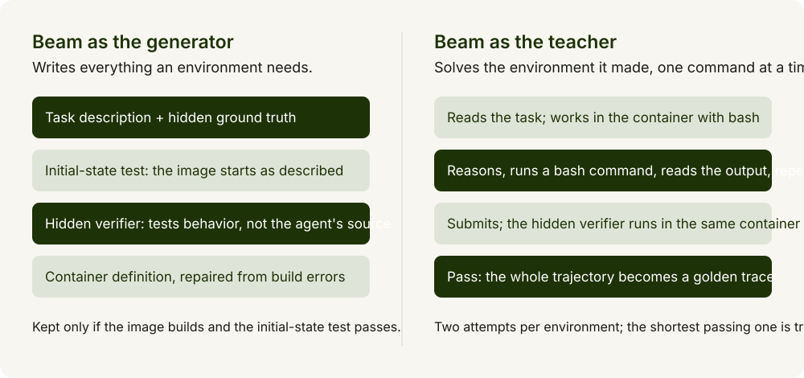
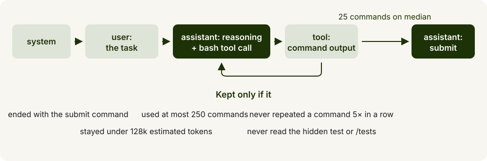
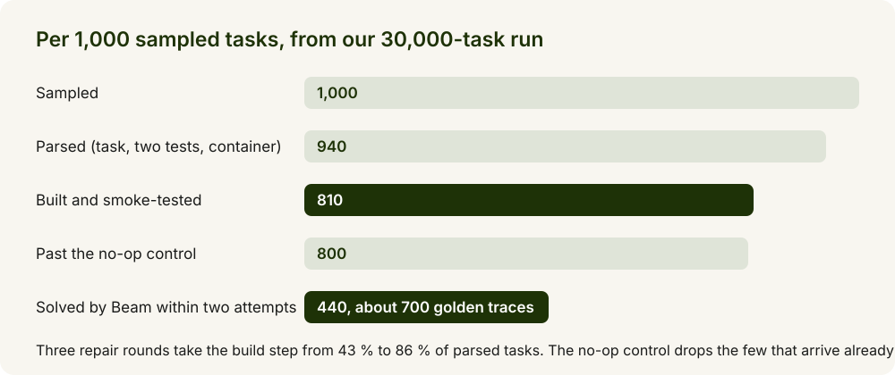

# Synthetic SWE environments with Beam

*Generate verified environments with Beam, then collect Beam's own solutions as golden traces*

Beam writes software-engineering environments through [TMax](https://github.com/hamishivi/tmax), Ai2's open-source task generator. Only environments a hidden test can verify survive. Beam then solves them, the test grades every attempt, and the passing trajectories become training data for a small model.



## How it works

- **TMax samples a task** from independent axes: domain, skill, persona, difficulty, verifier kind.
- **Beam writes four artifacts** for it: the task with a hidden ground truth, a test that pins down the starting state, a hidden test that decides whether the task was solved, and a container definition.
- **The only quality gate is executable**: the image builds and passes its initial-state test. Build errors go back to Beam for up to three repair rounds. No second model judges the first, which is why this scales.
- **Beam then solves what it made**, in a shell with a single bash tool, inside [Harbor](https://github.com/laude-institute/harbor). The hidden test grades the attempt.



## What counts as a golden trace

A passing trajectory is kept only if it:

- ended with the submit command, in at most 250 commands, under 128k estimated tokens
- never repeated the same command five times in a row
- never read the hidden test. A student trained on that trace learns to look for the answer key.

A no-op control run first drops environments that pass with no work at all (the setup script already produced the answer). When both attempts pass, the shortest is `trace_0`.



## What to expect



- From our 30,000-task run: about 810 working environments and 440 solved ones per 1,000 sampled, with a median of 25 commands and about 30,000 characters of reasoning per trace.
- Nine domains: software engineering, debugging, data science, system administration, security, file operations and more. "SWE environment" here means anything an engineer solves at a terminal.
- The companion recipe, Distil a SWE agent into Gemma 4 E4B (`recipes/customization/sft/distil-swe-agent/`), trains on these traces (`TRACES="beam=output/traces/beam" bash train.sh`) and evaluates on Harbor task folders from `output/harbor/`. Set aside environments whose traces you do not train on; they are the held-out set.

## Before you start

- A Reflection API key for `reflection/Beam-1.0-501B-A23B`. Copy the cookbook's `.env.example` (at the root of this cookbook) to `.env` in this folder and fill in `REFLECTION_API_KEY`. Use a key made for this run and rotate it afterwards: the agent runs inside each task's container, so the key is visible to generated task code. (litellm has no `reflection` provider yet, so the two scripts hand it the API through its generic OpenAI-compatible provider; that is the only place the mapping lives.)
- A Linux machine with Docker; budget about 1 GB of disk per built task.
- [TMax](https://github.com/hamishivi/tmax) at commit `6d3d606c`, installed as its README says, with [Apptainer](https://apptainer.org/) for its builds; set `TMAX_DIR` to the checkout.
- [Harbor](https://github.com/laude-institute/harbor) `0.22.0` with its Docker environment. It installs mini-swe-agent `2.4.6` into each task container for you.

This recipe runs both tools unmodified. Everything it adds is in `config/` and a few scripts.

| Run | Machine | What it took |
| --- | --- | --- |
| Reference run, 100 tasks | GCE `c4-standard-96`, Docker 29.8, recipe defaults (16 API streams, 4 build workers, 8 parallel trials) | 10 min of API calls, 47 min of builds, 11 min of control runs |
| Full run, 30,000 tasks | Same machine, 30 API streams, 6 build workers, 64 parallel trials | About 5 h of API calls and 25 h of builds per 1,000 tasks |

## Run it

```bash
pip install -r requirements.txt
export TMAX_DIR=/path/to/tmax
bash run_all.sh
```

`run_all.sh` runs four stages into `output/` and skips what an earlier run finished, so you can stop and restart it or run the stages by hand.

**1. Generate.** TMax's own launcher with the values in `config/generate.env` (model, concurrency, corpus kind, build workers). Survivors land in `output/tasks/<task>/`. From the reference run:

```
Generating 100 task templates with 16 concurrency (corpus_kind=rl_v2)
Stages 1-3 complete: 89 intermediates (saved to output/tasks/_intermediates.jsonl)
Stage 4: 89 defs to process (89 total, 0 already done)
  Round 0/3 done: 53 succeeded, 36 failed  (cumulative: 53/89)
  Round 1/3 done: 21 succeeded, 15 failed  (cumulative: 74/89)
  Round 2/3 done: 2 succeeded, 13 failed  (cumulative: 76/89)
  Round 3/3 done: 3 succeeded, 10 failed  (cumulative: 79/89)
  Overall rate:      79.0%
  Total time:        46.8 min
```

The repair rounds are worth it: 53 definitions built on the first try, 79 after three rounds. Stage 4 is where the hours go, so give `DEF_BUILD_WORKERS` as many cores as you can spare.

**2. Convert.** TMax's `convert_to_harbor.py` turns every new task into a Harbor task folder under `output/harbor/`. These folders are the dataset, and later the held-out evaluation tasks for a trained model.

**3. Control and solve.** `solve.sh` runs Harbor twice, with the limits from `config/task_overrides.toml` written into each staged `task.toml` (Harbor's defaults are too short for these tasks):

- the no-op agent on every environment; one that passes untouched is dropped
- Beam through mini-swe-agent, two attempts per environment, with `config/agent.json` (250 steps, 300 s per command, 16,384 output tokens, temperature 1.0). `state.py` reads Harbor's results to decide what still needs a run.

From the reference run, 79 environments through the control in 11 minutes, one dropped:

```
┏━━━━━━━━┳━━━━━━━┓
┃ Reward ┃ Count ┃
┡━━━━━━━━╇━━━━━━━┩
│ 0.0    │    78 │
│ 1.0    │     1 │
└────────┴───────┘
need_control 0 | control_running 0 | control_failed 1 | verifier_broken 0 | env_broken 0 | need_solve 78 | solve_running 0 | solved 0 | failed 0
```

Expect about 43 solved environments and 70 traces from the 78, at the full run's 55 to 57 % pass rate.

**4. Export.** `export.py` applies the acceptance checks and writes `output/traces/beam/<task>/trace_<n>.json`, at most two per task, plus a `manifest.tsv`. Each file holds the task name and the messages exactly as mini-swe-agent recorded them (system, user, assistant turns with `reasoning_content` and `tool_calls`, tool outputs), which is what the SFT recipes read. Look at a few with `harbor view output/jobs` before training.

**Smoke test.** `python3 smoke_test.py` builds a synthetic Harbor job (one task, two passing attempts, two that read the hidden test), exports it and checks the layout, in a second without Docker or the API:

```
ok: 1 task, 2 traces | export: 1 tasks, 2 traces -> /tmp/tmpx/traces/beam/ | {'accepted': 2, 'rejected: reads the hidden test': 2}
```

## Resume and scale

- **Resume**: rerun `bash run_all.sh`; every stage skips what is done and the export rebuilds `traces/` from scratch.
- **Scale**: raise `NUM_TASKS`, `MAX_CONCURRENCY`, `DEF_BUILD_WORKERS` and `TRIALS`. The API allows 600 requests and 30M tokens a minute per key.
- **Mix**: `CORPUS_KIND=legacy` for exact-text verifiers and text-only tasks; `rl_v2` (default) for every verifier and fixture kind.
- **Harder data**: solve each task with the student too (`solve.sh` takes `MODEL` and `API_BASE`) and keep only what the student fails.

## Fixes we patched on TMax locally

Our corpus came from TMax at `6d3d606c` plus eight small changes in a patched copy; the recipe runs stock TMax. [TMAX_FIXES.md](TMAX_FIXES.md) lists each change with the file it touches, and [config/prompt_rules.md](config/prompt_rules.md) holds the prompt text; the prompt rules and the re-sampling matter most for yield. Problems you may hit while running are in [TROUBLESHOOTING.md](TROUBLESHOOTING.md).
