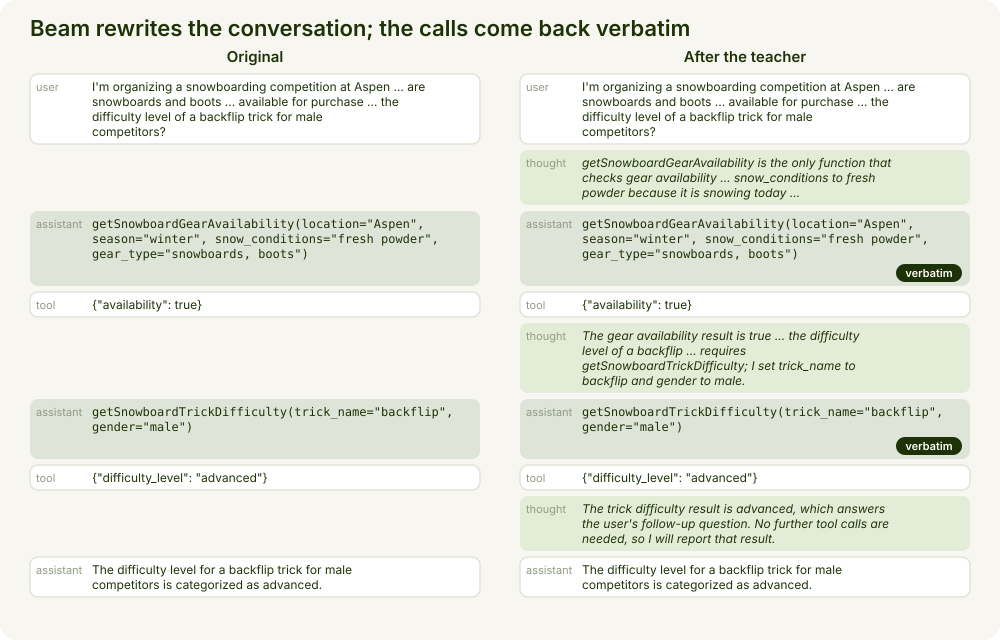
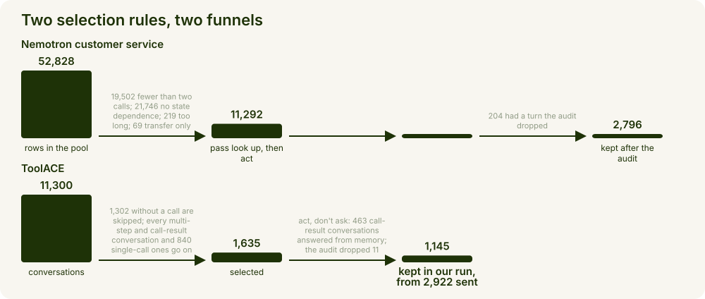
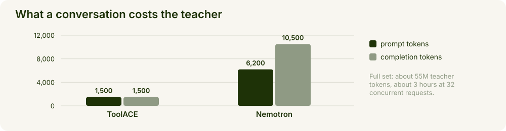
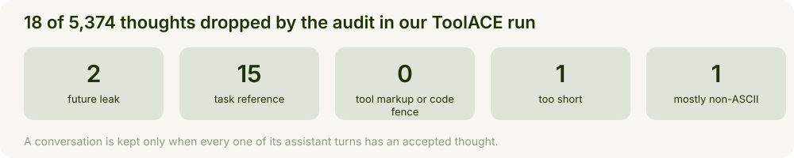

# Tool-calling reasoning data with Beam

Have Beam rewrite entire tool-calling conversations in one shot, adding token-efficient reasoning before every assistant turn, and turn the result into training data that makes a small model think briefly before it calls a tool.


This recipe is the left half; the TRL fine-tuning recipe in this cookbook is the right half.

| | |
| --- | --- |
| **Input** | [ToolACE](https://huggingface.co/datasets/Team-ACE/ToolACE) (Apache-2.0) and the customer-service half of [Nemotron-SFT-Agentic-v2](https://huggingface.co/datasets/nvidia/Nemotron-SFT-Agentic-v2) (CC-BY-4.0), at pinned revisions |
| **Teacher** | `Beam-1.0-501B-A23B` through the Reflection API, reasoning effort `max` |
| **Output** | `work/train.jsonl`: conversations in OpenAI chat format with a `reasoning_content` thought on every assistant turn; 3,941 in our run |
| **Cost** | Full set: about 55M teacher tokens, about 3 hours at 32 concurrent requests. Dry run: 2 minutes, about 370,000 tokens |
| **Result** | Gemma 4 E4B fine-tuned on this file gains 3.7 points on BFCL v4 at 45% fewer output tokens; E2B and 12B in the SFT recipe |

## What you'll build

Beam is a strong reasoning model, and that makes it a strong teacher. The thoughts it writes can be distilled into a much smaller model, and a student that has learned to think briefly and to the point before acting spends far fewer tokens than one left to think on its own. The recipe applies Beam to existing tool-calling datasets: Beam rewrites each conversation with a short thought before every assistant turn and changes nothing else. A thought is about 350 characters on average.

What Beam adds is judgement in context. The teacher sees the whole conversation at once, so each thought is written with the later turns in sight: it names the function it is about to call, justifies each argument, and says why a result settles the question or why another call is needed.



A real conversation from the first run. The reply is verified turn by turn: every assistant turn needs a thought and every tool call has to come back verbatim, so the teacher can change nothing but the thoughts.

## What you'll learn

- **Whole conversations, not single turns.** A thought that cannot see a later result cannot justify the call that uses it, so Beam writes every thought in one pass, and each tool call must come back verbatim.
- **Two rules shape the behaviour.** ToolACE conversations must *act, not ask*: a text reply with no tool result to draw on drops the conversation. Nemotron conversations must *look up, then act*: a call argument has to come from an earlier result. A good tool-calling assistant acts when it has what it needs, asks only when it must, and uses what it just learned.
- **The audit catches cheating thoughts.** A value quoted from the next tool result, or a mention of "the example" or "the rewrite", drops the whole conversation.



The look-up-then-act rule rejects more Nemotron rows than every other test combined, and the act-don't-ask rule is the most consequential line on the ToolACE side: what remains is the part of ToolACE that acts.

## What you need

- A Reflection API key in a `.env` file in this folder, as `REFLECTION_API_KEY=<your key>`; the cookbook's `.env.example` lists the variables, and the other two default to the API and Beam.
- A Linux machine with Python 3.12, 16 GB of RAM and 3 GB of disk, no GPU. `requirements.txt` pins the dependencies and `config.py` pins the two public dataset revisions.



| source | conversations sent | prompt tokens | completion tokens | median seconds per request | p95 |
| --- | --- | --- | --- | --- | --- |
| ToolACE, our run | 2,922 | 4.4M | 4.4M | 10 | 35 |
| Nemotron, our run | 3,000 | 18.5M | 31.5M | 59 | 188 |

The recipe skips the 1,302 conversations without a call that our run sent, so a full run sends about 1,635 ToolACE conversations and about 55M tokens in total; at 32 concurrent requests (`WORKERS=32 bash run.sh`; the default is 16) the teacher stage takes about 3 hours.

## Run it

### Try it in two minutes

```bash
pip install -r requirements.txt
echo 'REFLECTION_API_KEY=<your key>' > .env
LIMIT=20 bash run.sh                # 20 conversations per source
```

`run.sh` runs the six stages into `work/`, keeping 20 conversations of each source spread evenly over the selection. One line per stage tells you it worked:

```
toolace: 1635 rows selected; kinds={'call_result_answer': 493, 'continuation_chain': 302, 'single_call': 840}
nemotron: {"all": 52828, "fewer_than_2_calls": 19502, "no_state_dependence": 21746, "too_long": 219, "transfer_only": 69, "qualifying": 11292, "selected": 3000}
teacher done: ok_turns=54 bad=0 prompt_tokens=46,133 completion_tokens=43,834
teacher done: ok_turns=133 bad=0 prompt_tokens=126,792 completion_tokens=152,832
```

<details>
<summary>The full output of the first run</summary>

```
toolace: 1635 rows selected; kinds={'call_result_answer': 493, 'continuation_chain': 302, 'single_call': 840}
toolace: wrote 20 rows -> work/toolace_rows.jsonl
nemotron: streamed a pool of 52828 rows -> work/nemotron_pool.jsonl
nemotron: {"all": 52828, "fewer_than_2_calls": 19502, "no_state_dependence": 21746, "too_long": 219, "transfer_only": 69, "qualifying": 11292, "selected": 3000}
nemotron: wrote 20 rows -> work/nemotron_rows.jsonl
teacher: 20 conversations to rewrite (style=purpose) -> work/teacher_toolace.jsonl
teacher model: Beam-1.0-501B-A23B | temperature=0.2 | max_tokens=16384 | workers=16
teacher done: ok_turns=54 bad=0 prompt_tokens=46,133 completion_tokens=43,834
teacher: 20 conversations to rewrite (style=purpose) -> work/teacher_nemotron.jsonl
teacher model: Beam-1.0-501B-A23B | temperature=0.2 | max_tokens=16384 | workers=16
teacher done: ok_turns=133 bad=0 prompt_tokens=126,792 completion_tokens=152,832
```

The audit summaries and the assemble and mix statistics follow as JSON; `assemble` kept 12 of the 20 ToolACE conversations (8 replied in text without a result to draw on) and 19 of the 20 Nemotron ones (one lost a turn to the audit), and `mix` wrote 31 conversations with a mean thought of 342 characters. A progress bar runs during the teacher stage.

`ok_turns` counts assistant turns that received an accepted thought; `bad` counts conversations that failed every attempt. Those are retried the next time you run the same command, and completed conversations are matched to their rows by id, so a changed `LIMIT` or selection cannot mix thoughts up.

</details>

### Build the full set

```bash
bash run.sh
```

The same six stages without `LIMIT`, about 3 hours with `WORKERS=32` (the default is 16). The teacher stage appends to its output and resumes after an interruption, so after an outage you run the same command again. Its thought style is one sentence of the prompt in `teacher.py`:

> Write the thought the way a careful engineer thinks before acting: enough to justify the decision and each parameter value, and nothing that does not change the decision.

### Check the data



The future-leak check matters more than it sounds: the teacher sees results the student will not have seen when it writes its own thought, and a thought that leaks one teaches the student to invent results. A conversation is kept only when every assistant turn has an accepted thought.

```bash
python smoke_test.py
```

```
ok: parse, verify, clean, audit, assemble and mix on one conversation (2 thoughts, 2 rows mixed)
```

<details>
<summary>The remaining smoke-test lines</summary>

```
ok: parallel results land on their calls; a result with no call is rejected
ok: the ToolACE rule skips conversations without a call
ok: a conversation with a missing turn is sent again on resume
ok: a record whose id matches no conversation is skipped
ok: whitespace inside an argument value must match; line breaks between arguments may differ
skipped: live teacher check (REFLECTION_API_KEY is not set)
```

The test builds small tool-calling conversations and the replies a teacher gives for them, then runs every stage after the teacher on them. With `REFLECTION_API_KEY` set it also sends one conversation to the teacher and checks that both assistant turns received an accepted thought.

</details>

## Common fixes

[COMMON_FIXES.md](COMMON_FIXES.md) lists the symptoms we hit, their causes and the fix for each: a missing API key, dropped requests in the teacher stage, a slow teacher stage, a failed pool stream, a failed ToolACE download, and fewer rows than expected after `assemble`.

## Next steps

- **Fine-tune on `work/train.jsonl`.** The TRL fine-tuning recipe in this cookbook trains Gemma 4 on this file and evaluates before and after.
- **Use your own conversations.** Write them in the ToolACE row format or in OpenAI chat format and convert them with `nemotron.to_toolace_row`, then run `enrich`, `audit`, `assemble` and `mix` unchanged. To draw more data, raise the sample sizes in `config.py` and keep the audit.
- **Change the thought style** with `--thought-style verbose` or `concise`: verbose matched the recipe's accuracy at 25 to 30% more output tokens, concise saved another 25% of tokens but cost the 12B five points.
- **Related reading.** The [ToolACE paper](https://arxiv.org/abs/2409.00920) describes how its conversations and APIs were generated; the [Nemotron-SFT-Agentic-v2 card](https://huggingface.co/datasets/nvidia/Nemotron-SFT-Agentic-v2) describes the customer-service trajectories; [BFCL](https://gorilla.cs.berkeley.edu/leaderboard.html) is the benchmark the SFT recipe reports.
