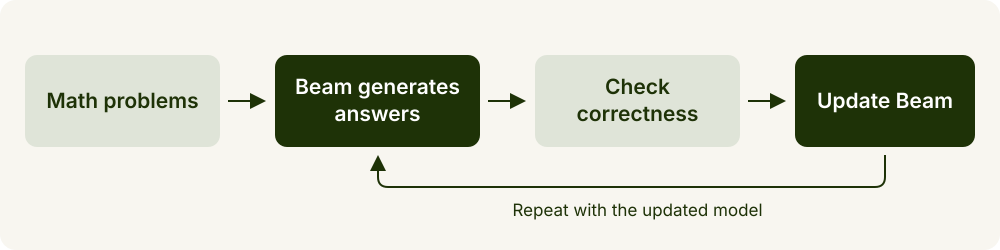
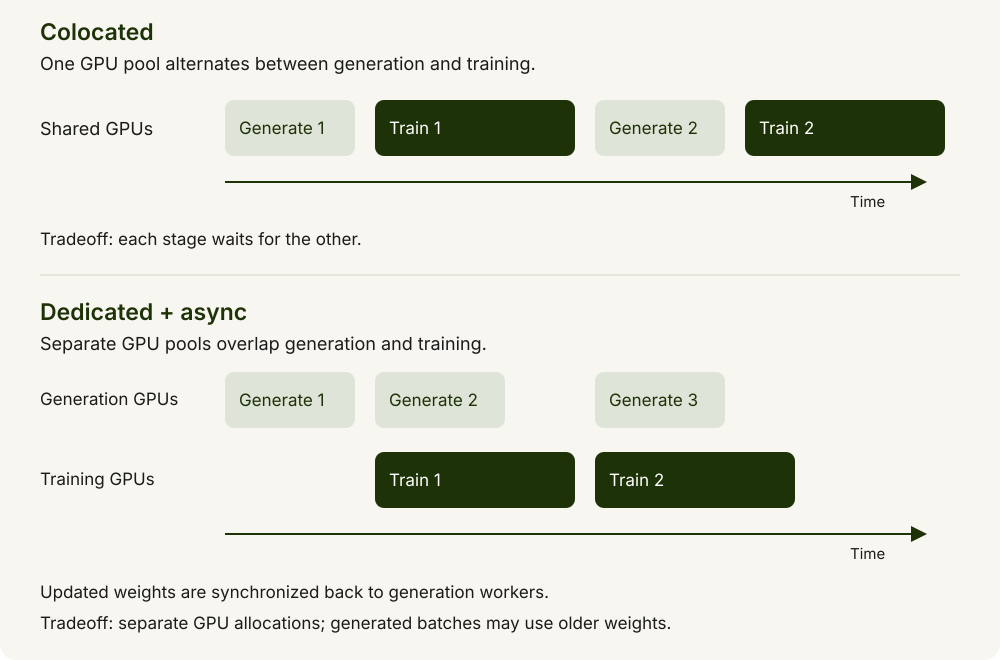
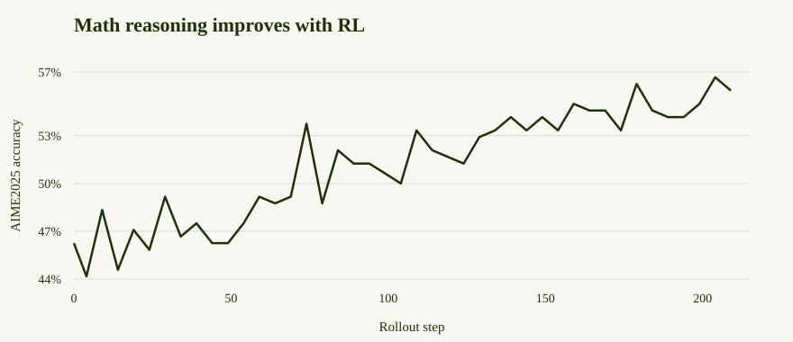
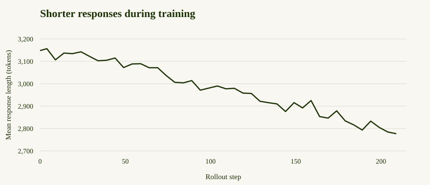

# Math reasoning RL with Miles

*Train Beam on verifiable tasks with Miles*


Train Beam to solve math problems more efficiently with reinforcement learning
using [Miles](https://miles.radixark.com/docs).



This recipe trains on [DAPO-Math-17K](https://huggingface.co/datasets/BytedTsinghua-SIA/DAPO-Math-17k),
a collection of math problems with reference answers that can be checked
automatically. Beam learns from the correctness of its answers, rather than
from worked solutions to imitate.

Training uses [**GRPO (Group Relative Policy Optimization)**](https://arxiv.org/abs/2402.03300): Beam generates
several answers to each problem, compares their rewards within the group, and
updates the model to favor better answers. The recipe draws on
[DAPO](https://dapo-sia.github.io/), which refines this approach with techniques
such as asymmetric clipping, which gives rewarded responses more room to
increase in probability, and penalties for overly long responses. The settings used by each configuration are described below.

To measure progress, we evaluate on [AIME2025](https://huggingface.co/datasets/zhuzilin/aime-2025),
a separate set of 30 competition math problems from the 2025 American
Invitational Mathematics Examination. These problems are used for evaluation,
not for training updates.

See the [Miles documentation](https://miles.radixark.com/docs) for more about the framework.

> **Note:** This recipe demonstrates how to train Beam with this RL framework
> and provides a reference configuration and example results. It is not intended
> to establish the model’s best achievable performance.

## Before you start

You need the [Beam-1.0-501B-A23B](https://huggingface.co/reflection/Beam-1.0-501B-A23B)
checkpoint, a [Miles Docker image](https://hub.docker.com/r/radixark/miles/tags?name=beam)
with Beam support, and GPUs.

This recipe has been validated on the hardware configurations below. You can
use a different setup by adjusting the parallelism and memory settings.

| Training | Configuration | Hardware | How it runs |
| --- | --- | --- | --- |
| Full-parameter | Dedicated, async | 12 nodes × 8 H200 GPUs | 64 GPUs train while 32 GPUs generate responses |
| Full-parameter | Colocated | 8 nodes × 8 H200 GPUs | All 64 GPUs alternate between training and generation |
| LoRA | Dedicated, async | 4 nodes × 8 H200 GPUs | 16 GPUs train adapters while 16 GPUs generate responses |

**Full-parameter vs LoRA.** Full-parameter training updates all model weights,
giving the model more flexibility to adapt but requiring more memory for gradients
and optimizer state. LoRA freezes the base model and trains small adapters,
reducing training memory requirements and checkpoint size. It offers fewer
trainable parameters, so the best choice depends on the task and available
hardware. Both approaches still need to load the base model to generate responses.


- **Colocated (shared GPUs):** training and response generation use the same
  GPUs in turn. The model generates a batch of responses, then trains on them
  before generating the next batch. This reuses the same GPU pool for both stages.
  The tradeoff is that training waits for generation and vice versa; switching
  between stages can also add memory-offloading overhead.
- **Dedicated GPUs with asynchronous training:** separate GPU pools train the
  model and generate responses concurrently. Generation can prepare the next
  batch while training processes an earlier one, reducing idle time. The
  generation workers receive updated model weights between batches. The tradeoff
  is that each stage needs its own GPU allocation, and asynchronous generation
  can use weights that lag behind the latest training update.



In Miles, both the dedicated full-parameter configuration and the LoRA
configuration use separate GPU pools and run asynchronously by default.
Use `--no-async-training` to make training and generation run in turn.

Make the model and datasets available at the same paths on every node, and use
a shared, persistent output directory for checkpoints and logs.

Storage requirements depend on the training configuration:

- **Full-parameter, dedicated:** each training node needs at least 2 TB of free
  local NVMe storage for offloaded optimizer state.
- **Full-parameter, colocated:** local NVMe stores optimizer state and also needs
  room to offload the trainer while the GPUs generate responses.
- **LoRA:** optimizer state stays on the GPUs, so no NVMe optimizer offload is needed.

If each training node has enough available host RAM, you can configure CPU-memory
offload instead of NVMe offload. The launchers below use NVMe by default; switching
to RAM requires adjusting their offload settings. See the
[Miles training backend guide](https://miles.radixark.com/docs/user-guide/training-backend)
for CPU-memory and NVMe offload options.

## Start the Docker containers

The Beam launch scripts are on Miles’ [beam-image branch](https://github.com/radixark/miles/tree/beam-image):
[`run_beam.py`](https://github.com/radixark/miles/blob/beam-image/scripts/run_beam.py)
for full-parameter training and
[`run_beam_lora.py`](https://github.com/radixark/miles/blob/beam-image/scripts/run_beam_lora.py)
for LoRA. Replace `/path/to/miles` with your checkout location, then clone this
branch and mount the checkout on every node:

```bash
git clone --branch beam-image https://github.com/radixark/miles.git /path/to/miles
cd /path/to/miles
```

Use the published [radixark/miles:beam image](https://hub.docker.com/layers/radixark/miles/beam/images/sha256-13ac9f4ceca97265381d98afeb0e53142991a379f5df287524d36a64eb3e65cb).

On each node, start the same Beam-compatible Miles image. Replace the host paths below with yours; `/path/to/miles` is your Miles checkout with
Beam support. Use shared storage for models, datasets, and outputs, and local
NVMe for `/scratch`.

```bash
export MILES_IMAGE="radixark/miles:beam"

docker run -it --rm --gpus all --network host --ipc host \
  -v /path/to/miles:/workspace/miles \
  -v /mnt/shared/models:/root/models \
  -v /mnt/shared/datasets:/data/datasets \
  -v /mnt/shared/outputs:/root/shared_data \
  -v /scratch:/scratch \
  -w /workspace/miles \
  "$MILES_IMAGE" bash
```

Run the remaining commands inside these containers. Prepare the model and data
once on the head node; the shared mounts make them available to every node.

## Prepare the model and data

```bash
python scripts/run_beam.py prepare \
  --model-id reflection/Beam-1.0-501B-A23B \
  --model-dir /root/models/Beam \
  --data-dir /data/datasets
```

This downloads Beam, DAPO-Math-17K for training, and AIME2025 for evaluation.

## Start the Ray cluster

Ray coordinates training and generation across the nodes. Start one Ray head
node and connect the remaining nodes as workers, using the same Docker image
with GPU access on every node. The Miles launcher submits jobs to this cluster.

If your infrastructure already provides a Ray cluster, use its head address and
skip the startup commands. Otherwise, run the following inside the Miles
containers, with networking that allows the nodes to reach each other.

On the **head node**, replace `10.0.0.1` with its private IP address:

```bash
export MASTER_ADDR=10.0.0.1
ray start --head \
  --node-ip-address="$MASTER_ADDR" \
  --port=6379 \
  --dashboard-host=0.0.0.0 \
  --dashboard-port=8265 \
  --num-gpus=8
```

On **each remaining node**, connect to that head:

```bash
export MASTER_ADDR=10.0.0.1
ray start --address="${MASTER_ADDR}:6379" --num-gpus=8
```

The head also contributes eight GPUs. On the head, check that `ray status` reports
all nodes and GPUs: 12 nodes / 96 GPUs for dedicated full-parameter training,
8 / 64 for colocated training, or 4 / 32 for LoRA.

Port `6379` is the cluster connection address; port `8265` serves the dashboard
and job-submission API. Keep Ray accessible only within your trusted cluster
network. See the [Ray cluster setup guide](https://docs.ray.io/en/latest/cluster/vms/user-guides/launching-clusters/on-premises.html)
for networking and container setup details.

## Start training

On the head node, set the address used by the Miles launcher:

```bash
export MASTER_ADDR=10.0.0.1
export RAY_ADDRESS="http://${MASTER_ADDR}:8265"
```

### 96 H200 GPUs (dedicated, full-parameter)

Use this configuration with 12 nodes of 8 H200 GPUs: 64 GPUs train the full
model while 32 GPUs generate responses asynchronously. Add
`--no-async-training` to run training and generation in turn.

```bash
python scripts/run_beam.py execute \
  --model-dir /root/models/Beam \
  --data-dir /data/datasets \
  --output-dir /root/shared_data/beam-math \
  --num-rollout 100
```
### 64 H200 GPUs (shared, full-parameter)

Use this configuration with 8 nodes of 8 H200 GPUs. All 64 GPUs alternate
between training the full model and generating responses. The paused trainer
is offloaded to node-local NVMe during generation.

```bash
python scripts/run_beam.py execute-colocate \
  --model-dir /root/models/Beam \
  --data-dir /data/datasets \
  --output-dir /root/shared_data/beam-math \
  --num-rollout 100
```
### 32 H200 GPUs (dedicated, LoRA)

Use this configuration with 4 nodes of 8 H200 GPUs: 16 GPUs train LoRA
adapters while 16 GPUs generate responses asynchronously. Train rank-16
adapters while keeping Beam's base weights frozen. Add
`--no-async-training` to run training and generation in turn.

```bash
python scripts/run_beam_lora.py execute \
  --model-dir /root/models/Beam \
  --data-dir /data/datasets \
  --output-dir /root/shared_data/beam-lora \
  --num-rollout 100
```

All three configurations use these defaults. The 96-GPU and 64-GPU configurations
update the full model; LoRA updates only the adapters.

- **Batch:** 32 prompts × 8 responses, followed by one optimizer update.
- **Token budget:** up to 1,024 prompt tokens and 4,096 response tokens.
- **Reward:** boxed-answer correctness with a soft penalty near the length limit.
- **Evaluation:** AIME2025 every five rollouts, with eight responses per problem.
- **Checkpoints:** saved every twenty rollouts in the output directory.

Evaluation reports answer accuracy without the length penalty. AIME2025 prompts do
not explicitly request boxed answers, so scoring relies on the model providing them.

Optimizer scratch defaults to `/scratch/beam-optimizer`. Use
`--optimizer-disk-dir` to change it. Rollout, evaluation, and training dumps are
saved under `<output-dir>/dumps`.

## Results

> **Note:** These results use a maximum of 4,096 output tokens per response. They illustrate
> training progress under this token budget and do not represent Beam’s performance
> with a larger output-token budget.

These curves show the **96 GPUs (dedicated)** full-parameter configuration
(12 nodes × 8 H200 GPUs, 64 training and 32 generating responses), evaluated
with Miles’ own prompt format and answer checking.





In this full-parameter run with a 4,096-token output limit, AIME2025 accuracy increases from 46.25% to 55.83%,
while mean response length
falls from 3,148 to 2,777 tokens (11.8% fewer tokens).

Accuracy improves while responses become shorter. The reward also penalizes
responses near the 4,096-token limit, so the reduction in length partly reflects
this training objective.

## Resume training

For full-parameter training, run the same command with `--resume` and a larger
`--num-rollout`:

```bash
python scripts/run_beam.py execute \
  --model-dir /root/models/Beam \
  --data-dir /data/datasets \
  --output-dir /root/shared_data/beam-math \
  --resume \
  --num-rollout 200
```

For the shared-GPU configuration, use `execute-colocate` instead of `execute`.
Keep the same model, data, output directory, and topology, with your Ray address
still set. Resume requires both the checkpoint and its saved dataset state.
`--num-rollout 200` means 200 rollouts in total, including those already completed.

For LoRA, add `--resume` to your `run_beam_lora.py execute` command, keeping the
same output directory. This restores the adapters, optimizer, and learning-rate
scheduler.
