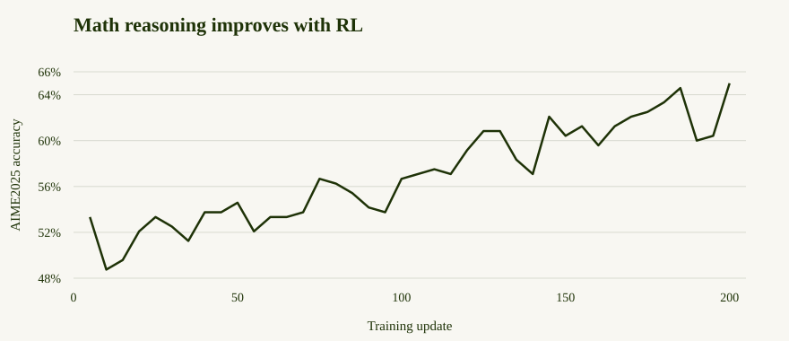
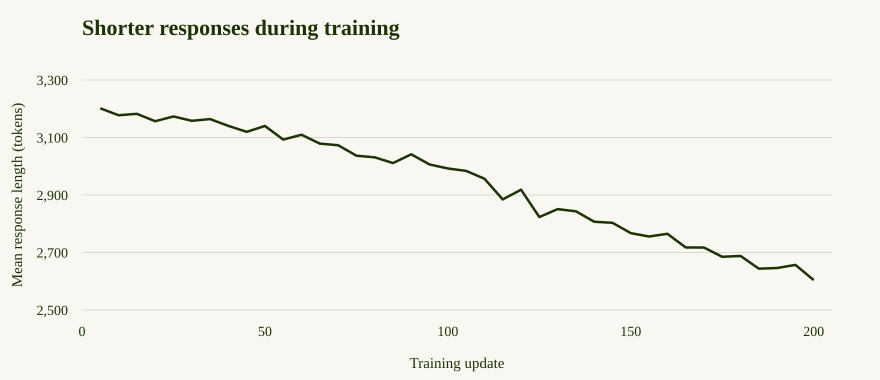

# Math reasoning RL with NeMo RL

*Train Beam on verifiable tasks with NeMo RL*


Train Beam to solve math problems more efficiently with reinforcement learning
using [NeMo RL](https://docs.nvidia.com/nemo/rl/latest/index.html).


This recipe trains on [DAPO-Math-17K](https://huggingface.co/datasets/BytedTsinghua-SIA/DAPO-Math-17k),
a collection of math problems with reference answers that can be checked
automatically. Beam learns from the correctness of its answers, rather than
from worked solutions to imitate.

Training uses [**GRPO (Group Relative Policy Optimization)**](https://arxiv.org/abs/2402.03300): Beam generates
several answers to each problem, compares their rewards within the group, and
updates the model to favor better answers. The recipe draws on
[DAPO](https://dapo-sia.github.io/), which refines this approach with techniques
such as asymmetric clipping, which gives rewarded responses more room to
increase in probability, and penalties for overly long responses. The settings used by each configuration are described below.

To measure progress, we evaluate on [AIME2025](https://huggingface.co/datasets/opencompass/AIME2025),
a separate set of 30 competition math problems from the 2025 American
Invitational Mathematics Examination. These problems are used for evaluation,
not for training updates.

See the [NeMo RL documentation](https://docs.nvidia.com/nemo/rl/latest/index.html) for more about the framework.

> **Note:** This recipe demonstrates how to train Beam with this RL framework
> and provides a reference configuration and example results. It is not intended
> to establish the model’s best achievable performance.

## Before you start

You need the [Beam-1.0-501B-A23B](https://huggingface.co/reflection/Beam-1.0-501B-A23B)
checkpoint, a NeMo RL Docker image with Beam support and the backends required
by your configuration, and GPUs.

The configurations below use shared or dedicated GPUs. You can use a different
setup by adjusting the parallelism and memory settings.

| Training | Configuration | Hardware | How it runs |
| --- | --- | --- | --- |
| Full-parameter | Colocated | 16 nodes × 8 H200 GPUs | All 128 GPUs alternate between training and generation |
| Full-parameter | Colocated | 8 nodes × 8 B300 GPUs | All 64 GPUs alternate between training and generation |
| Full-parameter | Dedicated, async | 16 nodes × 8 H200 GPUs | 96 GPUs train while 32 GPUs generate responses |

All three configurations use **full-parameter training**: they update all model
weights, giving the model more flexibility to adapt but requiring more memory
for gradients and optimizer state than adapter-based training such as LoRA.

- **Colocated (shared GPUs):** training and response generation use the same
  GPUs in turn. The model generates a batch of responses, then trains on them
  before generating the next batch. This reuses the same GPU pool for both stages.
  The tradeoff is that training waits for generation and vice versa; switching
  between stages can also add memory-offloading overhead.
- **Dedicated GPUs with asynchronous training:** separate GPU pools train the
  model and generate responses concurrently. Generation can prepare the next
  batch while training processes an earlier one, reducing idle time. The
  generation workers receive updated model weights between batches. The tradeoff
  is that each stage needs its own GPU allocation, and asynchronous generation
  can use weights that lag behind the latest training update.


In the dedicated NeMo RL configuration, generation pauses before receiving
updated weights (`in_flight_weight_updates: false`). Training and generation
can still overlap between these synchronization points.

Make the model available at the same path on every node, and use a shared,
persistent output directory for logs and evaluation results. The dedicated
configuration offloads half of the optimizer state to host RAM, so allow enough
CPU memory on each training node. See the
[NeMo RL documentation](https://docs.nvidia.com/nemo/rl/latest/index.html)
for training backend and memory configuration details.

## Start the Docker containers

The Beam configurations live on NeMo RL’s
[beam-support branch](https://github.com/NVIDIA-NeMo/RL/tree/beam-support).
Clone it and mount the checkout on every node:

```bash
git clone --branch beam-support --recurse-submodules https://github.com/NVIDIA-NeMo/RL.git nemo-rl
cd nemo-rl
```

Follow the [upstream Beam guide](https://github.com/NVIDIA-NeMo/RL/blob/beam-support/docs/guides/models/reflection/beam.md)
to build the image for your configuration: shared-GPU and dedicated async
recipes use different backend builds. Make that image available on every node
and replace `NEMO_RL_IMAGE` below with its reference.

On each node, start the same Beam-compatible NeMo RL image. Replace the image
and host paths below with yours; `/path/to/nemo-rl` is your checkout with Beam
support. Use shared storage for the model and outputs.

```bash
export NEMO_RL_IMAGE="<beam-compatible-nemo-rl-image>"

docker run -it --rm --gpus all --network host --ipc host \
  --ulimit memlock=-1 \
  -v /path/to/nemo-rl:/workspace/nemo-rl \
  -v /mnt/shared/models:/root/models \
  -v /mnt/shared/outputs:/root/shared_data \
  -e WANDB_API_KEY \
  -w /workspace/nemo-rl \
  "$NEMO_RL_IMAGE" bash
```

Run the remaining commands inside these containers. The image must include the
backends required by your configuration. See the
[NeMo RL installation guide](https://docs.nvidia.com/nemo/rl/latest/about/installation.html)
for image setup details.

## Prepare the model and data

Download the model once on the head node; the shared mount makes it available
to every node:

```bash
hf download reflection/Beam-1.0-501B-A23B --local-dir /root/models/Beam
```

NeMo RL downloads and formats DAPO-Math-17K for training and all 30 AIME2025
problems for evaluation automatically. No dataset preparation is needed.

Point the recipe to your model and output directory:

```bash
export BEAM_CHECKPOINT=/root/models/Beam
export BEAM_LOG_DIR=/root/shared_data/beam-nemo-rl
```

## Start the Ray cluster

Ray coordinates training and generation across the nodes. Start one head node
and connect the remaining nodes as workers. If your infrastructure already
provides a Ray cluster, skip these startup commands.

On the **head node**, replace `10.0.0.1` with its private IP address:

```bash
export MASTER_ADDR=10.0.0.1
ray start --head \
  --node-ip-address="$MASTER_ADDR" \
  --port=6379 \
  --dashboard-host=0.0.0.0 \
  --dashboard-port=8265 \
  --num-gpus=8
```

On **each remaining node**, connect to that head:

```bash
export MASTER_ADDR=10.0.0.1
ray start --address="${MASTER_ADDR}:6379" --num-gpus=8
```

The head also contributes eight GPUs. Run `ray status` on the head and check
for 16 nodes / 128 GPUs for either H200 configuration, or 8 nodes / 64 GPUs for
the B300 configuration. Port `6379` connects the cluster; port `8265` serves the
dashboard. Keep Ray accessible only within your trusted cluster network. See
the [Ray cluster setup guide](https://docs.ray.io/en/latest/cluster/vms/user-guides/launching-clusters/on-premises.html)
for networking details.

## Start training

Run the command for your configuration on the head node, in the same container
where you set `BEAM_CHECKPOINT` and `BEAM_LOG_DIR`. These commands use the
container’s Python environment, with the training and generation dependencies
for your chosen configuration already installed.

### 128 H200 GPUs (shared)
NeMo AutoModel trains with FSDP2 and expert parallelism across 128 GPUs.
Eight SGLang engines use 16 GPUs each. Training and generation run in turn.

```bash
python examples/run_grpo.py \
  --config examples/configs/recipes/llm/grpo-beam-501b-16n8g-fsdp2ep128-automodel-sglang.yaml
```
### 64 B300 GPUs (shared)
NeMo AutoModel trains with FSDP2 and expert parallelism across 64 GPUs.
Four SGLang engines use 16 GPUs each. Training and generation run in turn.

```bash
python examples/run_grpo.py \
  --config examples/configs/recipes/llm/grpo-beam-501b-8n8g-b300-fsdp2ep64-automodel-sglang.yaml
```
### 128 H200 GPUs (dedicated)
Megatron trains on 96 GPUs while two vLLM engines generate responses on
16 GPUs each. Training uses TP2, PP3, and EP32, with half of the optimizer
offloaded to CPU. Weight updates wait for generation to pause.

```bash
python examples/run_grpo.py \
  --config examples/configs/recipes/llm/grpo-beam-501b-16n8g-tp2pp3ep32-megatron-vllm-async.yaml
```

This configuration requires a NeMo RL image with Beam-compatible Megatron
Bridge and async vLLM support. Reward scaling and the overlong-response
penalty are disabled for asynchronous training.

All three configurations update the full model with these defaults:

- **Training:** 200 optimizer updates using GRPO.
- **Batch:** 32 prompts × 8 responses, followed by one optimizer update.
- **Token budget:** up to 1,024 prompt tokens and 4,096 response tokens.
- **Optimizer:** AdamW with a constant learning rate of `1e-6`.
- **Reward:** math-answer verification, with a soft penalty near the length limit
  in the shared-GPU configurations.
- **Evaluation:** AIME2025 every five updates, starting at update 5.

Each evaluation generates eight responses per problem, for 240 responses in
total. Accuracy is the fraction of individual responses marked correct by
`hf_math_verify`, not pass@8.

W&B logging and GPU monitoring are enabled. Configure W&B authentication in your
execution environment before launching.

## Results

> **Note:** These results use a maximum of 4,096 output tokens per response. They illustrate
> training progress under this token budget and do not represent Beam’s performance
> with a larger output-token budget.





In the 128-H200 shared-GPU run with a 4,096-token output limit, scored with
NeMo RL’s own prompt format and answer checking, AIME2025 accuracy increases from 53.33% at update
5 to 65.00% at update 200, while mean response length falls from 3,201 to 2,604
tokens (18.7% fewer tokens).

Accuracy improves while responses become shorter. The reward also penalizes
responses near the 4,096-token limit, so the reduction in length partly reflects
this training objective.

## Save outputs

Logs and validation outputs are written to `BEAM_LOG_DIR`. Preserve them before
releasing the cluster.

Checkpoint saving is disabled in the reference configurations. To save model and
optimizer state every 20 training steps, update the `checkpointing` section in
your chosen YAML file before launching:

```yaml
checkpointing:
  enabled: true
  checkpoint_dir: ${oc.env:BEAM_LOG_DIR}/checkpoints
  save_period: 20
  save_optimizer: true
```

Use persistent shared storage for this directory, accessible at the same path
on every node. The reported runs did not validate checkpoint saving or resume.
