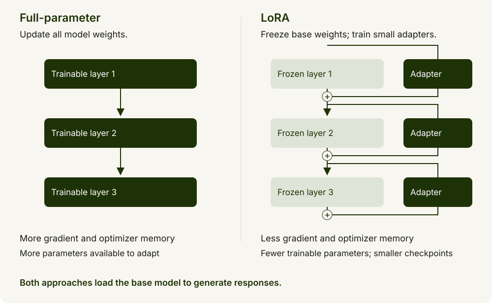
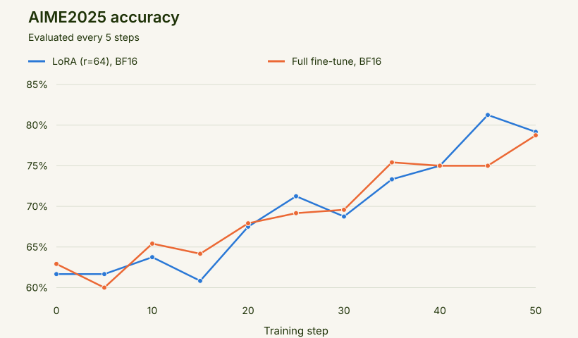
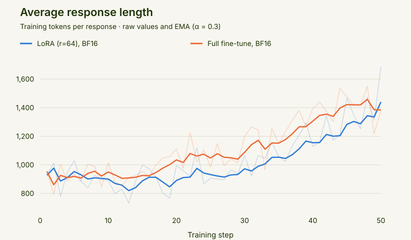
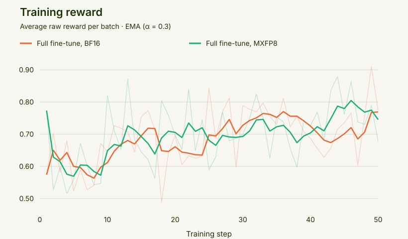
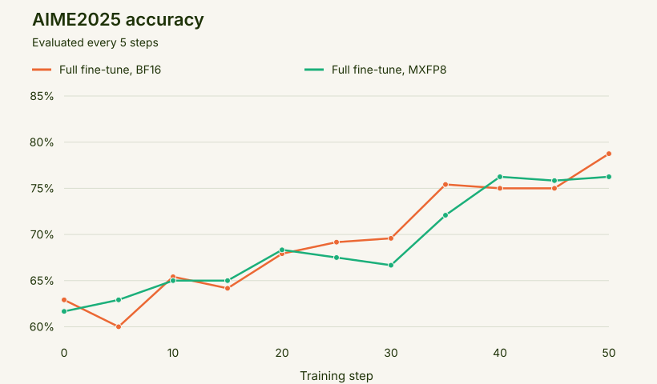

# Math reasoning RL with SkyRL

*Train Beam on verifiable tasks with SkyRL*

Train Beam to solve math problems with reinforcement learning using [SkyRL](https://docs.skyrl.ai/).
Megatron trains the model and vLLM generates responses.


This recipe trains on [DAPO-Math-17K](https://huggingface.co/datasets/BytedTsinghua-SIA/DAPO-Math-17k),
a collection of math problems with reference answers that can be checked
automatically. Beam learns from the correctness of its answers, rather than
from worked solutions to imitate.

Training uses [**GRPO (Group Relative Policy Optimization)**](https://arxiv.org/abs/2402.03300): Beam generates
several answers to each problem, compares their rewards within the group, and
updates the model to favor better answers. The recipe draws on
[DAPO](https://dapo-sia.github.io/), which refines this approach with techniques
such as asymmetric clipping, which gives rewarded responses more room to
increase in probability, and penalties for overly long responses. The settings used by each configuration are described below.

To measure progress, we evaluate on [AIME2025](https://huggingface.co/datasets/zhuzilin/aime-2025),
a separate set of 30 competition math problems from the 2025 American
Invitational Mathematics Examination. These problems are used for evaluation,
not for training updates. The launch scripts also evaluate on AIME2024.

See the [SkyRL documentation](https://docs.skyrl.ai/) for more about the framework.

> **Note:** This recipe demonstrates how to train Beam with this RL framework
> and provides a reference configuration and example results. It is not intended
> to establish the model’s best achievable performance.

## Before you start

You need the [Beam-1.0-501B-A23B](https://huggingface.co/reflection/Beam-1.0-501B-A23B)
checkpoint, a SkyRL environment with Beam-compatible Megatron Bridge and vLLM,
and GPUs.

The example scripts live on SkyRL's [beam-release branch](https://github.com/NovaSky-AI/SkyRL/tree/beam-release), under
`examples/train/models/reflection/beam/`. Clone the branch on the head node and
make the checkout available at the same path on every node:

```bash
git clone -b beam-release https://github.com/NovaSky-AI/SkyRL.git
cd SkyRL
```

LoRA supports as few as 2 nodes × 8 B200 GPUs with a smaller batch; the reference
LoRA run uses four nodes. You can use a different setup by adjusting the parallelism and memory
settings.

| Training | Configuration | Hardware | How it runs |
| --- | --- | --- | --- |
| LoRA | Small batch | 2 nodes × 8 B200 GPUs | Train adapters with a smaller batch while keeping the base model frozen |
| LoRA | Colocated | 4 nodes × 8 B200 GPUs | Training and generation share the GPUs; only adapters are trained |
| Full-parameter | Colocated, BF16 | 8 nodes × 8 B200 GPUs | Training and generation share the GPUs; the full model is trained |
| Full-parameter | MXFP8 | 8 nodes × 8 B200 GPUs | Train the full model and generate responses with MXFP8 |

**Full-parameter vs LoRA.** Full-parameter training updates all model weights,
giving the model more flexibility to adapt but requiring more memory for gradients
and optimizer state. LoRA freezes the base model and trains small adapters,
reducing training memory requirements and checkpoint size. It offers fewer
trainable parameters, so the best choice depends on the task and available
hardware. Both approaches still need to load the base model to generate responses.



**Colocated (shared GPUs)** means training and generation use the same GPUs in
turn. This reuses the GPU pool, but each stage waits for the other and switching
stages can add offloading overhead. Both LoRA configurations and the 64-GPU
BF16 configuration use this layout.

Make the model and datasets available at the same paths on every node, and use
shared, persistent storage for outputs.

For full fine-tuning, the optimizer state is streamed from node-local NVMe. The
reference run uses approximately 0.6–0.7 TB of optimizer storage per node;
a full-parameter checkpoint adds about 7 TB in total, or 0.9 TB per node.
Allow space for every checkpoint you keep and for other outputs. See the
[SkyRL Megatron guide](https://docs.skyrl.ai/docs/examples/megatron) for backend
configuration details.

The BF16 and MXFP8 launch commands below set `OPTIMIZER_STATE_DISK_DIR` to
node-local NVMe. To use the CPU optimizer instead, set
`OPTIMIZER_STATE_DISK_DIR=` (empty); this requires about 1.7 TB of host RAM per
node.

## Start the Docker containers

On each node, start the same Beam-compatible SkyRL image. Replace the host paths below with yours; `/path/to/SkyRL` is your checkout with Beam support.
Use shared storage for models, datasets, and outputs, and local NVMe for `/scratch`.

```bash
export SKYRL_IMAGE="novaskyai/skyrl-train-ray-2.57.0-py3.12-cu13.0-megatron-beam"

docker run -it --rm --gpus all --network host --ipc host \
  -v /path/to/SkyRL:/workspace/SkyRL \
  -v /mnt/shared/models:/root/models \
  -v /mnt/shared/datasets:/data/datasets \
  -v /mnt/shared/outputs:/root/shared_data \
  -v /scratch:/scratch \
  -e WANDB_API_KEY \
  -w /workspace/SkyRL \
  "$SKYRL_IMAGE" bash
```

Run the remaining commands inside these containers. See the
[SkyRL installation guide](https://docs.skyrl.ai/docs/getting-started/installation)
for the Megatron environment setup.

The image includes Beam builds of vLLM and Megatron Bridge as wheels under
`/opt/skyrl-wheels`, plus prebuilt FlashInfer kernels. The `beam-release`
`pyproject.toml` installs the Beam dependencies from that directory.

## Prepare the model and data

All four configurations train on DAPO-Math-17K and evaluate on AIME2024 and
AIME2025. Each Ray worker reads the model and data from local paths. Download
on every node, or once onto shared storage mounted at the same path everywhere:

```bash
hf download reflection/Beam-1.0-501B-A23B --local-dir /root/models/Beam

export MODEL_PATH=/root/models/Beam
export DATA_DIR=/data/datasets/dapo
DATA_DIR="$DATA_DIR" bash examples/train/algorithms/dapo/prepare_dapo_data.sh
```

The BF16 checkpoint is approximately 1 TB. The data preparation script writes
`dapo-math-17k-cleaned.parquet`, `aime-2024-cleaned.parquet`, and
`aime-2025-cleaned.parquet` into `DATA_DIR`.

## Start the Ray cluster

Ray coordinates training and generation across the nodes. Use one head node
and connect the others as workers. Skip startup if your infrastructure already
provides a cluster. Run these commands inside the containers.

On the **head node**, replace `10.0.0.1` with its private IP address:

```bash
export MASTER_ADDR=10.0.0.1
ray start --head --node-ip-address="$MASTER_ADDR" --port=6379 \
  --dashboard-host=0.0.0.0 --dashboard-port=8265 --num-gpus=8
```

On **each remaining node**:

```bash
export MASTER_ADDR=10.0.0.1
ray start --address="${MASTER_ADDR}:6379" --num-gpus=8
```

Run `ray status` on the head to check for 2 nodes / 16 GPUs, 4 / 32, or 8 / 64,
depending on your configuration. The head contributes eight GPUs. Keep Ray
accessible only within your trusted cluster network.

## Start training

Run your configuration's launch command from the head node, inside the container.
Set the paths used by the scripts:

```bash
export MODEL_PATH=/root/models/Beam
export DATA_DIR=/data/datasets/dapo
export ENV_FILE=/path/to/.env
export CKPT_PATH=/root/shared_data/skyrl-beam/checkpoints
export EXPORT_PATH=/root/shared_data/skyrl-beam/exports
```

Use separate output paths for each run. The scripts default to 50 training
steps (`MAX_TRAINING_STEPS`) and evaluation every five steps.

### 16 B200 GPUs (LoRA)


Train rank-64 adapters with alpha 64 on all linear layers at a learning rate
of `1e-5`. Megatron uses TP4, EP8, and PP2; vLLM uses one TP8 × PP2 replica.
The smaller batch uses 32 prompts × 8 responses and one optimizer update per
training step.

```bash
bash examples/train/models/reflection/beam/run_dapo_beam_lora_2node.sh
```

### 32 B200 GPUs (LoRA)


Train rank-64 adapters with alpha 64 on all linear layers at a learning rate
of `1e-5`. Megatron uses TP4, EP8, and PP2; vLLM uses two TP8 × PP2 replicas.

```bash
bash examples/train/models/reflection/beam/run_dapo_beam_lora_4node.sh
```

### 64 B200 GPUs (BF16)


Update the full model at a learning rate of `1e-6`. Megatron uses TP4, EP8,
and PP4; vLLM uses four TP8 × PP2 replicas. FP32 master weights and Adam
moments stay on local NVMe and stream through the GPU one bucket at a time.

```bash
OPTIMIZER_STATE_DISK_DIR=/scratch/skyrl_optimizer_state \
  bash examples/train/models/reflection/beam/run_dapo_beam_fullft_8node.sh
```

### 64 B200 GPUs (MXFP8)


Use MXFP8 matrix multiplications with BF16 primary weights. Megatron uses
TP4, EP8, and PP8. vLLM uses eight single-node replicas, each with TP8 and
EP8, and receives weights in MXFP8. Layer norms and router parameters retain
their original precision.

```bash
OPTIMIZER_STATE_DISK_DIR=/scratch/skyrl_optimizer_state \
  bash examples/train/models/reflection/beam/run_dapo_beam_fp8_fullft_8node.sh
```

The LoRA scripts enable per-expert adapter slots in vLLM, pinned host staging
for adapter synchronization, sequence-parallel input regathering, and fused
LM-head log-probabilities with logit softcapping.

The 32-GPU LoRA and 64-GPU BF16 results below cover 50 training steps. These reference runs use the following settings:

- **Training:** GRPO with clip-higher, for 50 training steps and 100 optimizer updates.
- **Batch:** 64 prompts × 8 responses, split into two mini-batches per training step.
- **Token budget:** up to 2,048 prompt tokens and 8,192 response tokens.
- **Generation:** temperature `1.0`, top-p `1.0`, and minimal reasoning effort.
- **Reward:** math correctness with the DAPO overlong-response penalty.
- **Routing:** Rollout Routing Replay (R3) enabled.
- **Sampling:** dynamic sampling disabled.
- **Evaluation:** AIME2025 with eight responses per problem, reported as average accuracy.

## Checkpoints and resuming

The scripts write checkpoints to `CKPT_PATH` and exports and evaluation dumps
to `EXPORT_PATH`. If unset, these default to `$HOME/ckpts/<run name>` and
`$HOME/exports/<run name>`.

LoRA saves adapters every 10 steps (`CKPT_INTERVAL`). To resume, rerun the same
launch command with `RESUME_MODE=latest` and the same `CKPT_PATH`.

BF16 and MXFP8 full fine-tuning save every 25 steps and resume from the latest
checkpoint in `CKPT_PATH` by default. Each node needs room for its approximately
0.9 TB share of every checkpoint retained.

To select a checkpoint explicitly, set `RESUME_MODE=from_path` and pass the
Hydra override `trainer.resume_path=<checkpoint dir>` to the launch script.

## Results

> These results use a maximum of 8,192 output tokens per response, with minimal reasoning effort. They illustrate
> training progress under this token budget and do not represent Beam’s performance
> with a larger output-token budget.

The results below compare **32 B200 GPUs (LoRA)** (4 nodes × 8 GPUs) with
**64 B200 GPUs (BF16 full fine-tuning)** (8 nodes × 8 GPUs).



With an 8,192-token response limit and minimal reasoning effort, the reference
runs report AIME2025 average accuracy increasing from approximately 61% to 79%
over 50 training steps. LoRA and full fine-tuning achieve similar results over
these short runs.

Rollout Routing Replay reduces the difference between rollout and training
log-probabilities from approximately 0.02 to 0.008.



Mean response length on the training dataset increases from approximately
950 to 1,400 tokens. These are training response lengths, not AIME2025 evaluation
response lengths.

## MXFP8 training

The MXFP8 results use **64 B200 GPUs (MXFP8 full fine-tuning)** (8 nodes × 8
GPUs), with MXFP8 mixed-precision training and MXFP8 rollouts.
The reference experiment reports 44% higher generation throughput than BF16,
with similar reward and evaluation accuracy over 50 training steps. MXFP8
quantization is applied to the linear layers in the attention and MLP blocks,
while other layers like the router and layer norms are kept in their original precision.

Training reward tracks BF16 closely over the 50-step run, with comparable
learning progress under MXFP8. AIME2025 evaluation accuracy also improves in
both runs, but fluctuates: the benchmark contains only 30 problems, so small
differences between evaluation points should be interpreted cautiously.





The KV cache uses BF16 by default. `KV_CACHE_DTYPE=fp8_e4m3` increases decode
speed, with a reported increase of 0.01 in the mean Megatron–vLLM
log-probability difference.

Even with R3, MXFP8 rollouts have a log-probability difference of about 0.03, partly
due to different kernels in Megatron and vLLM. Switching from Flash Attention 4
to Flash Attention 2 reduces it to about 0.02. The script enables geometric
sequence masking, dropping sequences whose geometric-mean probability ratio
falls outside `[0.99, 1.01]`.

FlashInfer tunes the MXFP8 MoE kernels on first use, which can take several minutes.

See the [upstream Beam guide](https://docs.skyrl.ai/docs/examples/beam)
for Beam-specific setup and the [SkyRL documentation](https://docs.skyrl.ai/)
for general training and configuration guides.
