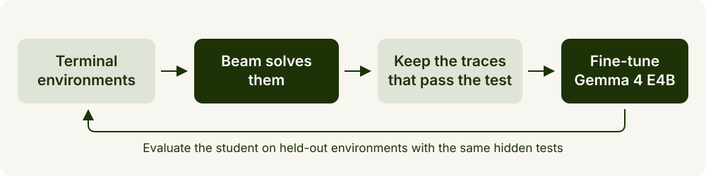
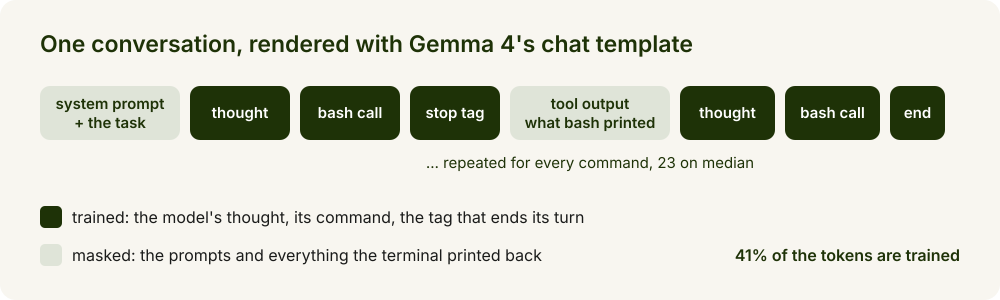
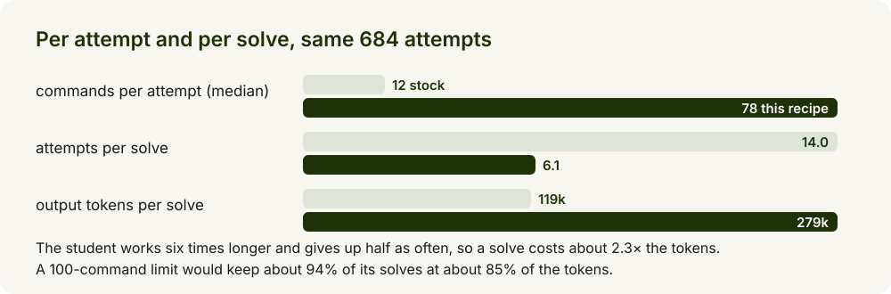
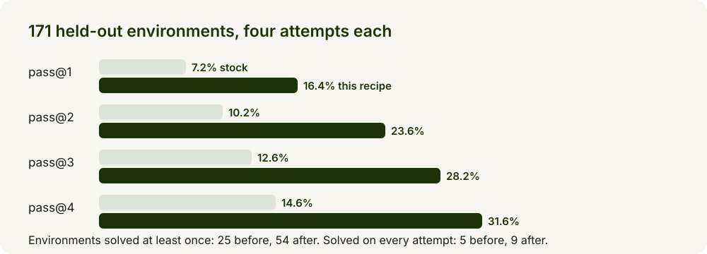
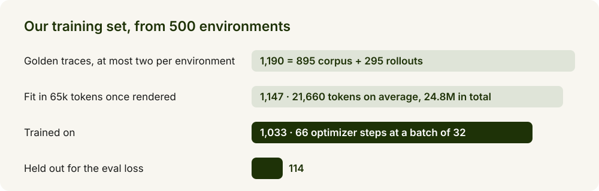
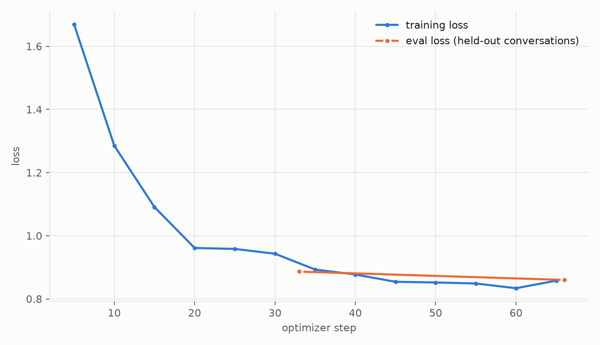

# Doubling synthetic env tasks solve rate using Beam

*Distil a SWE agent into Gemma 4 E4B by fine-tuning on Beam's golden traces*

Twice as many held-out software-engineering environments solved, from one afternoon of training on one node. The teacher is Beam, the student is Gemma 4 E4B, and the only judge is each environment's hidden test.



## How it works

- **The data is golden traces** from the companion recipe, Synthetic SWE environments with Beam (`recipes/customization/data-synthesis/synthetic-environment-gen`): Beam's reasoning, every bash command it ran and every output it saw, kept only when the environment's hidden test passed.
- **The prompts are swapped for the evaluation prompts.** The teacher ran with extra editing rules; the student is served without them. Strip them from the data and the habits transfer to the plain prompt.
- **The student is graded only on what Beam wrote.** The thought, the command and the tag that ends the turn are trained; the prompts and the terminal output are masked.
- **Training is plain supervised fine-tuning**, all language-model weights, two epochs. A generation check gates the export, because a scrambled save has normal tensor statistics.



## What the student learns

Not the answers: the evaluation environments are new. It learns a way of working. One environment side by side; the task is a broken vendored audit package to fix and run over 200 JSONL events.

| | stock | this recipe |
| --- | --- | --- |
| reads the code | edits the Makefile three times from the task text | dumps every file in the package, counts the real events |
| finds the bug | deletes the failing import | runs `make all`, renames one module to the name the imports expect |
| checks its work | overwrites the input file with ten fake rows so the pipeline runs | re-runs the target, prints the report to check its schema |
| result | verifier fails on `record_count: 6 == 200`, 0 of 4 attempts | 6 of 6 tests, 4 of 4 attempts, 53 commands |



## What to expect



- Four attempts per environment, plain agent configuration: temperature 1.0, 16k output tokens, thinking on, no decoding tricks. pass@k is the chance that at least one of k attempts passes the hidden tests, averaged over environments.
- Attempts are sampled and training is not deterministic. A second training run with the scripts in this folder scored 13.6% / 20.0% / 24.0% / 26.9% and solved 46 environments, 38 shared with the first. Treat gaps under 3 points as noise; rank candidates on a subset of 60 environments at two attempts each before spending a day on the full set.
- The obvious data is not the best data. Students trained only on traces rolled out through the evaluation harness collapsed into repetition from the first step; the same rollouts mixed beside Beam's corpus traces gave the best model. Keep the corpus traces as the base of the mix.

## Before you start

- `google/gemma-4-E4B-it` at revision `ee0ef6023621cff504d758262d4e04895a5af4a2`. Gemma is gated: accept the license on the model page and set `HF_TOKEN` (the cookbook's `.env.example` lists it).
- Golden traces as the companion recipe writes them, `traces/<source>/<env_id>/trace_<n>.json`, each `{"task": "<env_id>", "messages": [...]}`. Our run used two sources from the same teacher on 500 training environments: 895 traces Beam wrote when the environments were created (`corpus`) and 295 from running Beam again with stricter editing instructions (`rollouts`). The second source raised pass@1 from 13.6% to 16.4%.
- Held-out environments as Harbor task folders, the companion recipe's `output/harbor/`, never used for training.
- `requirements.txt`, pinned. Training ran with Python 3.12 and CUDA 13.

| Stage | Hardware | What it took |
| --- | --- | --- |
| Train | 1 node, 8x NVIDIA B300 (`NUM_GPUS=4` also works, same effective batch) | 3 h 27 min, 66 optimizer steps |
| Serve | 4 GPUs, SGLang | |
| Evaluate | Docker, about one CPU core per parallel attempt; we used 32 cores and 24 attempts | 7 h 40 min for 684 attempts |

## Run it

```bash
pip install -r requirements.txt
hf download google/gemma-4-E4B-it --revision ee0ef6023621cff504d758262d4e04895a5af4a2 --local-dir models/gemma-4-E4B-it
TRACES="corpus=traces/corpus rollouts=traces/rollouts" NUM_GPUS=8 bash train.sh
```

`train.sh` runs three scripts into `runs/e4b-distil/`. Extra arguments go to the trainer, for example `--epochs 3`.

**1. Prepare.** `prepare.py` keeps at most two traces per environment from each source, cuts every thought to about 2,000 characters at a sentence boundary, swaps in the standard prompts, renders with Gemma 4's chat template and builds the loss mask. Traces above 220,000 characters, containing Gemma's control tags, or above 65,536 tokens once rendered are left out; a tenth of the rest is held out for the eval loss. From our traces:

```
{"rows": 1190, "environments": 499, "dropped_too_long": 43, "train": 1033, "val": 114, "tokens_mean": 21660, "tokens_max": 65489, "total_tokens": 24844002}
```



**2. Train.** `train_sft.py` with FSDP: 2 epochs, learning rate 1e-5, cosine with 3% warmup, one conversation per GPU per step and an effective batch of 32, bf16, gradient checkpointing, vision and audio towers frozen. One weights-only checkpoint per epoch; every logged value in `checkpoints/log_history.json`.



The training loss drops below 1.0 in 20 steps and flattens near 0.85; the eval loss keeps falling through the second epoch (0.886, then 0.860). Three epochs did not help.

**3. Export.** `export.py` re-saves the last checkpoint in bf16 with the base model's config files, loads it on one GPU and answers a tool-calling question with thinking on. The run fails unless the text is readable and the thought channel opens.

```
EXPORT_OK runs/e4b-distil/export
```

**4. Serve.** Four single-GPU SGLang replicas behind one port, with Gemma 4's tool-call and reasoning parsers:

```bash
docker run --rm --gpus all --shm-size=16g --ipc=host -p 30000:30000 \
  -v "$PWD/runs/e4b-distil/export:/model:ro" lmsysorg/sglang:nightly-dev-20261002-67eab570 \
  python3 -m sglang.launch_server --model-path /model --served-model-name gemma-4-e4b-distil \
  --host 0.0.0.0 --port 30000 --dp-size 4 --mem-fraction-static 0.85 --trust-remote-code \
  --tool-call-parser gemma4 --reasoning-parser gemma4
```

**5. Evaluate.** mini-swe-agent through Harbor, four attempts per environment, then pass@k. Run it against the stock model, served the same way, for your own baseline.

```bash
TASKS_DIR=/path/to/heldout-tasks bash evaluate.sh
```

```
environments=171 attempts=684
pass@1=16.4%  pass@2=23.6%  pass@3=28.2%  pass@4=31.6%
```

**Smoke test.** `python smoke_test.py` writes five invented traces and checks the prompt normalization, the thought cap, the per-environment limit, the control-tag filter and the loss mask, in a second without a GPU or the model:

```
ok: rows: per-env limit, prompts normalized, thought capped, tag dropped
ok: loss mask covers thoughts, calls, stop tags and the turn end
ok: smoke test passed
```

## Adapt it

- **Your own environments and teacher**: `prepare.py` only needs the trace layout above, and the teacher can be any model mini-swe-agent can drive. Keep the held-out environments apart from the ones the teacher saw.
- **Gemma 4 12B**: `MODEL_DIR` is the only change; `train.sh` picks the decoder layer class for FSDP from the model config. Expect about twice the time per step.
- **A cheaper agent**: the student's solves come from working longer. A step limit of 100 keeps about 94% of them at about 85% of the tokens.

Problems you may hit while running are in [TROUBLESHOOTING.md](TROUBLESHOOTING.md).
