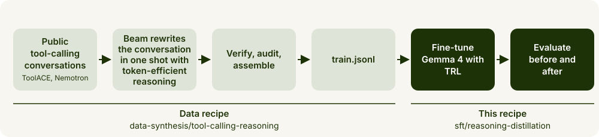
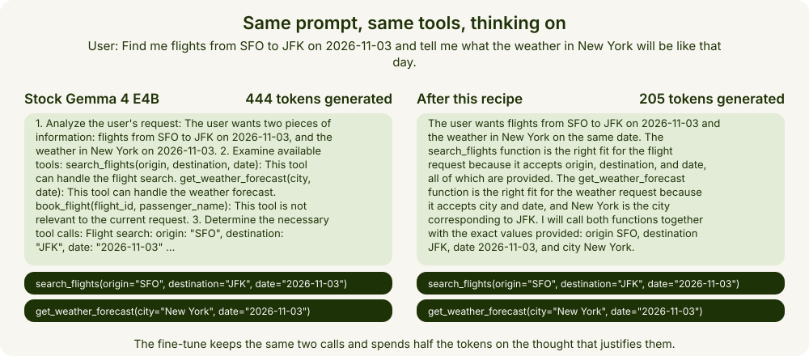
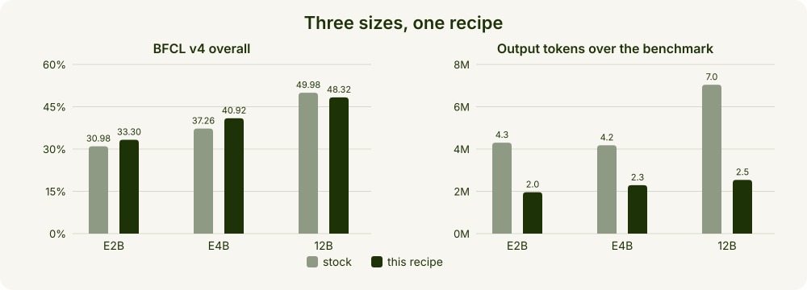
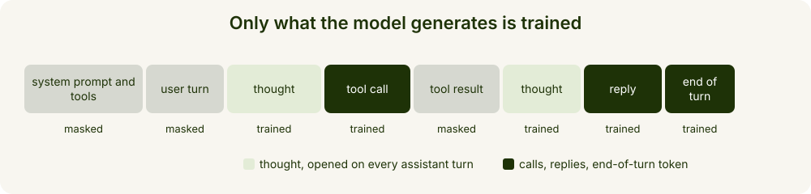
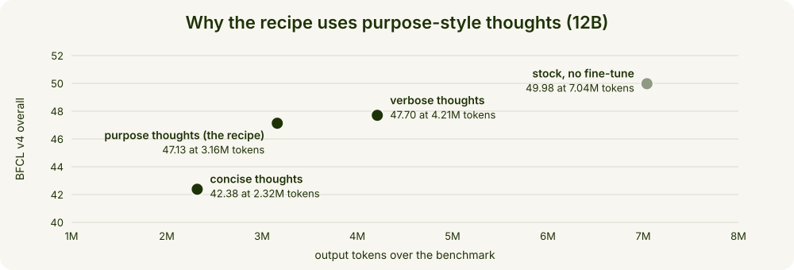
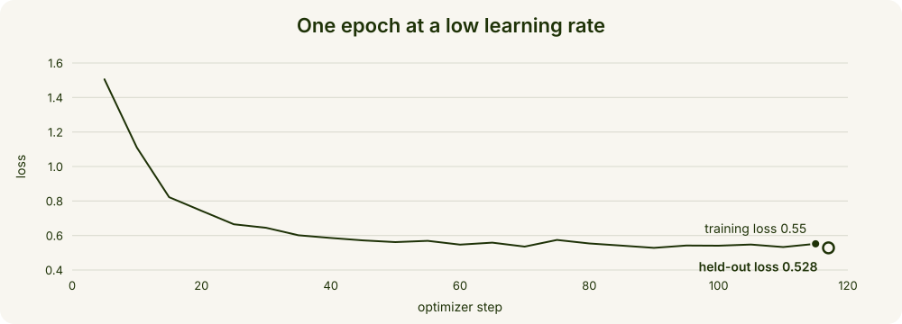
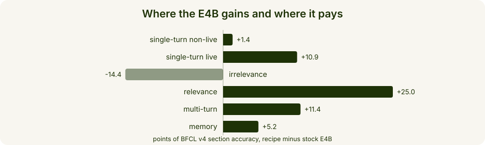

# Token-efficient tool calling with Beam as the teacher

Fine-tune Gemma 4 E4B with TRL and FSDP on tool-calling conversations whose thoughts Beam wrote: 45% fewer output tokens and 3.7 more points on BFCL v4, in a 14 to 19 minute run on one node.



This recipe is the right half of the path; the tool-calling reasoning data recipe in this cookbook is the left half.

| | |
| --- | --- |
| **Model** | Gemma 4 E4B, with the E2B and 12B shown to generalise |
| **Data** | `train.jsonl` from the data recipe: 3,941 conversations with a Beam-written thought before every assistant turn |
| **Compute** | one node of 8 B300 GPUs, 14 to 19 minutes for the E4B |
| **Result** | BFCL v4 overall 37.26 to 40.92, output tokens 4.18M to 2.29M (-45%) |
| **Evaluation** | BFCL v4 under one convention for stock and fine-tune, without the web-search category |



The mechanism is Gemma 4's own thinking channel. The stock model deliberates in numbered lists before every call; the fine-tune keeps the channel and replaces the habit with a short thought that names the function and justifies each argument. Nothing else changes: same tokenizer, same template, same serving stack.

<details>
<summary>Both generations in full, as decoded from the model (greedy, thinking on)</summary>

Stock Gemma 4 E4B, 444 tokens in 19.5 s:

```
<|channel>thought
1. **Analyze the user's request:** The user wants two pieces of information:
    * Flights from SFO to JFK on 2026-11-03.
    * The weather in New York on 2026-11-03.

2. **Examine available tools:**
    * `search_flights(origin, destination, date)`: This tool can handle the flight search.
    * `get_weather_forecast(city, date)`: This tool can handle the weather forecast.
    * `book_flight(flight_id, passenger_name)`: This tool is not relevant to the current request.

3. **Determine the necessary tool calls:**
    * **Flight search:**
        * `origin`: "SFO"
        * `destination`: "JFK"
        * `date`: "2026-11-03"
        * Call: `search_flights(origin="SFO", destination="JFK", date="2026-11-03")`
    * **Weather forecast:**
        * `city`: "New York" (JFK is in New York, so "New York" is the appropriate city name for the weather tool).
        * `date`: "2026-11-03"
        * Call: `get_weather_forecast(city="New York", date="2026-11-03")`

4. **Construct the final response:** Since both requests can be fulfilled simultaneously using different tools, the model should return both tool calls in a list.

5. **Format the output:** Generate the JSON array containing the two tool calls.<channel|><|tool_call>call:search_flights{date:<|"|>2026-11-03<|"|>,destination:<|"|>JFK<|"|>,origin:<|"|>SFO<|"|>}<tool_call|><|tool_call>call:get_weather_forecast{city:<|"|>New York<|"|>,date:<|"|>2026-11-03<|"|>}<tool_call|><eos>
```

After this recipe, 205 tokens in 8.8 s:

```
<|channel>thought
The user wants flights from SFO to JFK on 2026-11-03 and the weather in New York on the same date. The search_flights function is the right fit for the flight request because it accepts origin, destination, and date, all of which are provided. The get_weather_forecast function is the right fit for the weather request because it accepts city and date, and New York is the city corresponding to JFK. I will call both functions together with the exact values provided: origin SFO, destination JFK, date 2026-11-03, and city New York.
<channel|><|tool_call>call:search_flights{date:<|"|>2026-11-03<|"|>,destination:<|"|>JFK<|"|>,origin:<|"|>SFO<|"|>}<tool_call|><|tool_call>call:get_weather_forecast{city:<|"|>New York<|"|>,date:<|"|>2026-11-03<|"|>}<tool_call|><|tool_response>
```

On the simpler prompt "What's the weather forecast for Paris on 2026-11-03?" the stock model generates 326 tokens and the fine-tune 127, again with the same call.

</details>

> **Note on the benchmark.** We ran BFCL v4 without its web-search category, which needs a search API key. BFCL's overall formula counts a missing category as zero, so the overall scores on this page are lower than a full run would give, for the stock models and the fine-tunes alike. The before-and-after deltas are unaffected, because both sides were scored the same way.

## What you'll build



A Gemma 4 E4B checkpoint that writes a short thought before every tool call and keeps acting through multi-step tasks, exported in Hugging Face format and ready to serve with SGLang. The same data, settings and scripts, with only `BASE_MODEL` changed, take the E2B from 30.98 to 33.30 at 54% fewer output tokens and hold the 12B at 48.32 against 49.98 at 64% fewer, so what you learn on the E4B carries to the other sizes. Every row was measured with thinking on and the model's own thoughts kept in the chat history; tokens are the model's output summed over the 4,906 scored entries.

<details>
<summary>The numbers behind the chart</summary>

| Model | BFCL v4 overall | Change | Output tokens | Change | Mean latency per entry |
| --- | --- | --- | --- | --- | --- |
| Gemma 4 E4B IT, stock | 37.26 | - | 4.18M | - | 5.2 s |
| Gemma 4 E4B IT, this recipe | 40.92 | +3.66 | 2.29M | -45% | 3.8 s |
| Gemma 4 E2B IT, stock | 30.98 | - | 4.30M | - | 3.7 s |
| Gemma 4 E2B IT, this recipe | 33.30 | +2.32 | 1.96M | -54% | 2.3 s |
| Gemma 4 12B IT, stock | 49.98 | - | 7.04M | - | 12.4 s |
| Gemma 4 12B IT, this recipe | 48.32 | -1.66 | 2.54M | -64% | 4.6 s |

The 12B row is one seed; three seeds of the same recipe average 47.1, and run-to-run variance at this learning rate is about plus or minus 3 points overall, plus or minus 8 on multi-turn and plus or minus 15 on memory.

</details>

## What you'll learn



- **A thought on every turn, trained only on the model's own spans.** Gemma 4's template renders a thought only on tool-call turns and the last round; the recipe opens it on every assistant turn, and the labels cover the thought, the calls, the reply and the closing token.



- **Why the thoughts are this length.** On the 12B, verbose thoughts score 47.70 at 4.21M tokens, the recipe's purpose-style thoughts 47.13 at 3.16M (three-seed mean; the served seed 48.32 at 2.54M), concise thoughts 42.38 at 2.32M. The prompt asks for enough to justify the decision and each argument, and nothing more.
- **One epoch at 3e-6.** Higher rates over-fit the data's habits and cost the 12B multi-turn accuracy; a second epoch helps the small models by about a point and hurts the 12B.
- **Compare fairly.** One handler for the stock model and the fine-tune, thinking on, thoughts kept in history; compare multi-turn and memory across seeds, not single runs.

## What you need

| Size | GPUs | Training time | Held-out loss |
| --- | --- | --- | --- |
| E4B | 8x B300 (288 GB) | 14 to 19 min | 0.528 |
| E2B | 8x B300 | 15 min | 0.634 |
| 12B | 8x B300 | 26 to 32 min | 0.505 to 0.516 across seeds |

- Pinned by `download.sh` and `requirements.txt`: the three Gemma 4 instruction-tuned checkpoints, which are public, and the training stack of our runs on Python 3.12 with CUDA 13.0 wheels for `torch`.
- `train.jsonl` from the tool-calling reasoning data recipe in this cookbook; its `LIMIT=20` mode gives a small file for a dry run. The evaluation needs BFCL, which `eval_install.sh` installs, and an SGLang build with Gemma 4 support.

## Run it

### Train

```bash
pip install -r requirements.txt
MODEL=E4B bash download.sh
BASE_MODEL=/data/gemma-4-E4B-it DATA=/data/train.jsonl bash train.sh
```

`train.sh` renders the conversations with the thinking gate open on every assistant turn and masks everything the model did not generate, fine-tunes for one epoch at a learning rate of 3e-6 under FSDP, and exports the epoch checkpoint behind the generation gate. It refuses a `RUN_DIR` that already holds checkpoints. The last line of a successful run:

```
EXPORT_OK $RUN_DIR/export
```



The held-out loss is the signal that the training works: the loss on 200 conversations the model never trains on. It lands near 0.53 for the E4B with this data, near 0.51 for the 12B and near 0.63 for the E2B.

<details>
<summary>The full transcript of our E4B run (paths shortened, progress bars and library warnings removed)</summary>

```
START base=$BASE_MODEL model_type=gemma4 wrap=Gemma4TextDecoderLayer
{
  "input_rows": 3941,
  "train": 3741,
  "val": 200,
  "dropped_too_long": 0,
  "dropped_render_error": 0,
  "tokens_mean": 3574,
  "tokens_p95": 6010,
  "tokens_max": 7973,
  "trainable_ratio_mean": 0.314,
  "total_tokens": 14084118,
  "max_len": 12288
}
model: Gemma4ForConditionalGeneration | trainable 7.46B | frozen towers 0.48B | examples 3741 | world 8 | steps 117 | warmup 4 | effective batch 32
{'loss': '1.506', 'grad_norm': '14.02', 'learning_rate': '3e-06', 'entropy': '0.4887', 'num_tokens': '5.823e+05', 'mean_token_accuracy': '0.698', 'epoch': '0.04274'}
{'loss': '1.11', 'grad_norm': '2.939', 'learning_rate': '2.986e-06', 'entropy': '0.6023', 'num_tokens': '1.201e+06', 'mean_token_accuracy': '0.7305', 'epoch': '0.08547'}
...
{'loss': '0.5328', 'grad_norm': '1.174', 'learning_rate': '3.695e-08', 'entropy': '0.5575', 'num_tokens': '1.252e+07', 'mean_token_accuracy': '0.8266', 'epoch': '0.9402'}
{'loss': '0.5519', 'grad_norm': '1.402', 'learning_rate': '5.214e-09', 'entropy': '0.5664', 'num_tokens': '1.31e+07', 'mean_token_accuracy': '0.8222', 'epoch': '0.9829'}
{'eval_loss': '0.5281', 'eval_runtime': '6.638', 'eval_samples_per_second': '30.13', 'eval_steps_per_second': '1.958', 'eval_entropy': '0.5613', 'eval_num_tokens': '1.336e+07', 'eval_mean_token_accuracy': '0.8253', 'epoch': '1'}
{'train_runtime': '1156', 'train_samples_per_second': '3.235', 'train_steps_per_second': '0.101', 'train_loss': '0.648', 'epoch': '1'}
TRAIN_DONE
loaded Gemma4ForConditionalGeneration from $RUN_DIR/checkpoints/checkpoint-117 in 11s; 7.94B params
generation (thinking=True): '<|channel>thought\nThe user wants the weather in Paris. The available function get_weather is the only relevant function, and it requires the city parameter. Paris is the requested city, so I will call get_weather with city set to "Paris".\n<channel|><|tool_call>call:get_weather{city:<|"|>Paris<|"|>}<tool_call|><|tool_response>'
generation (thinking=False): '<|tool_call>call:get_weather{city:<|"|>Paris<|"|>}<tool_call|><|tool_response>'
SMOKE_OK
EXPORT_OK $RUN_DIR/export
```

A step took about 6 seconds and the epoch 19 minutes. `loss` is the training loss of the logged step, which jumps from step to step because every step sees different conversations; `mean_token_accuracy` is the share of trained tokens the model predicts correctly. The run folder holds `dataset/` and `dataset_val/`, `checkpoints/checkpoint-117/` with `trainer_state.json` and `train_info.json` beside it, `export/` with `SMOKE_OK`, and the filled-in `fsdp.yaml`.

</details>

Then print the losses and check the export:

```bash
python check_run.py
python smoke_test.py
```

```
held-out loss after step 117: 0.5281
ok: 4 weight file(s), 23 logged steps, training loss 1.506 -> 0.552, held-out loss 0.528
```

<details>
<summary>Full output of check_run.py</summary>

```
step  training loss  learning rate
   5         1.5056  3.00e-06
  10         1.1099  2.99e-06
  15         0.8221  2.94e-06
  20         0.7432  2.87e-06
  25         0.6650  2.77e-06
  30         0.6445  2.65e-06
  35         0.6016  2.51e-06
  40         0.5857  2.34e-06
  45         0.5716  2.16e-06
  50         0.5618  1.97e-06
  55         0.5690  1.77e-06
  60         0.5472  1.56e-06
  65         0.5587  1.35e-06
  70         0.5358  1.15e-06
  75         0.5744  9.50e-07
  80         0.5538  7.62e-07
  85         0.5415  5.88e-07
  90         0.5282  4.32e-07
  95         0.5419  2.96e-07
 100         0.5408  1.84e-07
 105         0.5477  9.69e-08
 110         0.5328  3.69e-08
 115         0.5519  5.21e-09
held-out loss after step 117: 0.5281
training time: 19.3 minutes
training loss, mean of the first and last 5 logged steps: 0.969 -> 0.543
saved loss_curve.png
```

</details>

### Evaluate before and after

Score the stock model first, so the baseline is your own, then the fine-tune, under one handler: thinking on, and the model's own thoughts kept in the chat history. BFCL v4 scores six sections over 4,906 entries.

```bash
BFCL_DIR=/data/gorilla bash eval_install.sh
bash eval_serve.sh google/gemma-4-E4B-it
mkdir -p /data/bfcl-stock && echo 'REMOTE_OPENAI_BASE_URL=http://localhost:30000/v1' > /data/bfcl-stock/.env
bash eval_run.sh /data/bfcl-stock google/gemma-4-e4b-it-thinking-keephist-FC
```

Then the fine-tune, served under its own name into a second project root, and the comparison:

```bash
bash eval_serve.sh /data/gemma4-tool-reasoning/export gemma-4-e4b-it-tool-reasoning
mkdir -p /data/bfcl-finetune && echo 'REMOTE_OPENAI_BASE_URL=http://localhost:30000/v1' > /data/bfcl-finetune/.env
bash eval_run.sh /data/bfcl-finetune google/gemma-4-e4b-it-tool-reasoning-FC
python eval_analyze.py /data/bfcl-finetune google_gemma-4-e4b-it-tool-reasoning-FC \
  --baseline /data/bfcl-stock google_gemma-4-e4b-it-thinking-keephist-FC
```



Relevance up 25 points and multi-turn up 11 are the recipe's gains: the model reaches for a tool when one fits and keeps going through multi-step tasks. Irrelevance down 14 is its cost on the E4B: a model that reaches for tools more readily also reaches for them a few times when none fits.

<details>
<summary>Output of eval_analyze.py for our E4B reference runs</summary>

```
section                    score  baseline   delta
single-turn non-live        82.2      80.8    +1.4
single-turn live            76.1      65.2   +10.9
irrelevance                 78.5      92.9   -14.4
relevance                   81.2      56.2   +25.0
multi-turn                  34.1      22.8   +11.4
memory                      32.3      27.1    +5.2
overall (BFCL formula)    40.92%
multi-turn diagnostics: {"entries": 800, "step_limit_hits": 15, "repeated_call_entries": 11, "inference_errors": 2}
output tokens (scored entries): 2.29M over 4906 entries; mean latency 3.8 s
```

Sections are unweighted means of their categories; the overall number is BFCL's own formula, read from `score/data_overall.csv`, with the web-search category counted as zero on both sides. The diagnostics count multi-turn entries that hit BFCL's step limit, repeated the same call three times in a row, or ended in an inference error. Tokens and latency sum the server's `usage` over every call of an entry, excluding the 111 memory prerequisite entries that BFCL does not score.

</details>

The same `eval_serve.sh` serves the export for your own use, with Gemma 4's tool-call and reasoning parsers on.

## Common fixes

[COMMON_FIXES.md](COMMON_FIXES.md) lists the symptoms we hit, their causes and the fix for each: out of memory in the first steps, a chat template the recipe does not know, an export that prints `SMOKE_FAIL`, a serving image that cannot load the exported config, a `transformers` that predates Gemma 4, a held-out loss that does not fall, inference errors in the analysis, and a registry entry that breaks the overall number.

## Next steps

- **Train on your own data.** One conversation per line as `{"id": ..., "tools": [...], "messages": [...]}`, with OpenAI-style `tools`, a `reasoning_content` field on every assistant message and structured `tool_calls` where the assistant calls a tool. Keep a thought on every assistant turn, including text replies, and hold a few hundred conversations out.
- **Change the dose with care.** Higher learning rates over-fit the data's habits; a second epoch helps the small models by about a point and hurts the 12B.
- **Compare seeds, not single runs,** when a difference is within a few points on multi-turn or memory; those sections move by 8 to 15 points between seeds of the same recipe.
