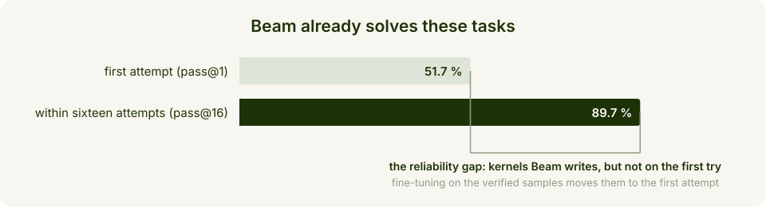
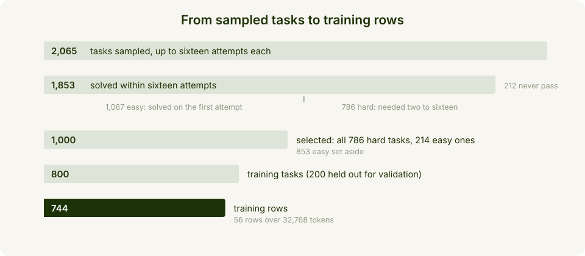
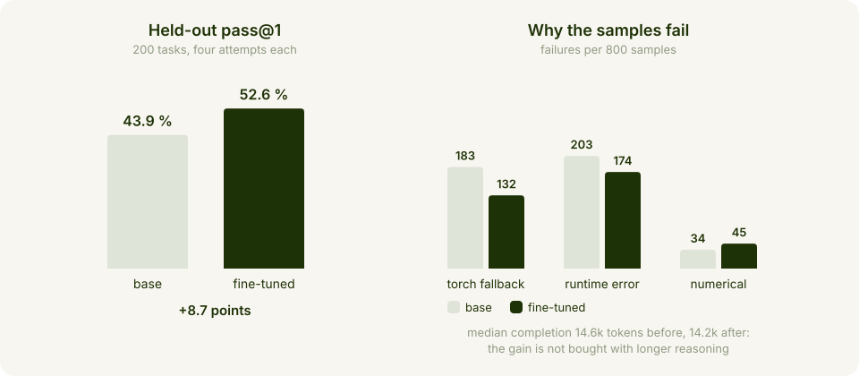
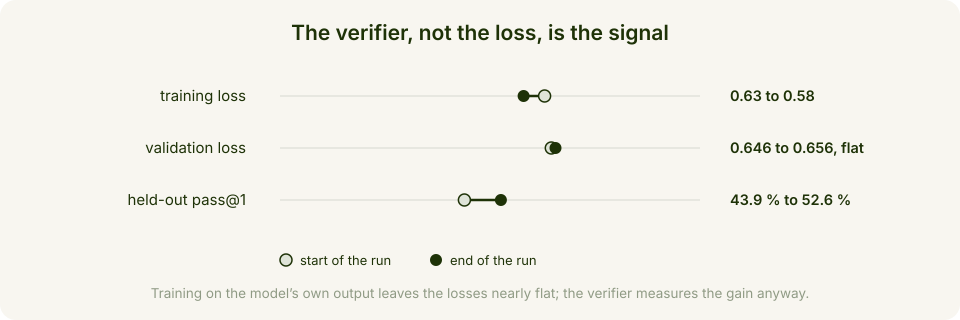
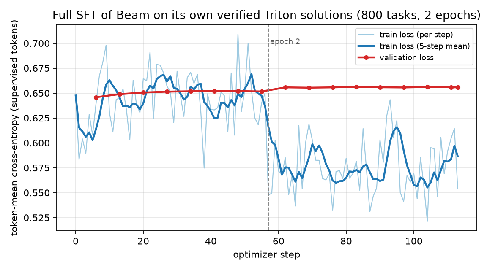

# Teaching Beam to write better GPU kernels in Triton

*Beam fine-tunes itself on its own verified Triton kernels: no teacher model, no human-written kernels*

Beam raises its own first-try reliability on held-out Triton kernel generation from 43.9 % to 52.6 % pass@1, a gain of 8.7 points, using nothing but its own verified solutions. The loop: serve Beam, let it attempt each task several times, keep every kernel that passes an automated correctness check, and fine-tune Beam on what passed. Beam turns extra inference compute into permanent model improvement, with correctness guaranteed by verification rather than by a larger model or expert annotators.


| | |
| --- | --- |
| **Model** | `Beam-1.0-501B-A23B`, full-parameter SFT with [NeMo AutoModel](https://github.com/NVIDIA-NeMo/Automodel) |
| **Data** | Beam's own passing kernels: the first verified sample per task, 744 training rows |
| **Verifier** | compile the kernel, run it, compare against the reference module; no judge model, no annotators |
| **Compute** | sampling: an endpoint serving Beam plus one H200 for the verifier; training: 8 nodes of 8x H200, 114 steps |
| **Result** | pass@1 43.9 % to 52.6 % on 200 held-out tasks, completion length unchanged |

> **Note:** self-distillation adds no knowledge to the model. Beam already solves most of these tasks when it is given several attempts; the fine-tuning refines that existing ability so that the first attempt succeeds more often.

This matters beyond Triton. The same loop applies to any task with an automated checker: generate, verify, train, repeat. Beam is the kind of model that gets better the more you use it.

## How it works

- **Each task is a PyTorch module** that implements an operation (attention variants, normalisations, convolutions, losses, fused MLP blocks and so on), combined with input generators, the dtype and the numerical tolerances. The module is both the specification and the ground truth.
- **Beam answers with a single Python file**: one or more `@triton.jit` kernels and a `ModelNew` class with the same interface as the reference, so the Triton implementation drops in for it. One prompt, no tools, one shot at maximum reasoning effort.
- **The verifier is executable and exact.** It compiles and runs the file on an H200, compares the outputs with the reference on several input shapes and seeds within the stated tolerances, and rejects "kernels" that quietly compute the result with torch operations, never launch a kernel, or violate the interface contract.
- **Sampling is rejection sampling.** Temperature 1, one attempt at a time, up to sixteen attempts per task, stop at the first pass. The first passing sample becomes the training example: the model's own reasoning plus its final answer.

Why this works: for a specialised skill like GPU kernel writing there is no stronger model to learn from, so the usual distillation playbook does not apply. What the task offers instead is a cheap and exact verifier, and that lets Beam become its own teacher — rejection-sampling fine-tuning, also known as expert iteration. Beam is unusually well suited to it because its latent capability is large:



Beam already knows how to write almost all of these kernels. The remaining gap is not a knowledge gap but a reliability gap, and reliability is exactly what fine-tuning on verified self-samples closes: the compute spent on retries at training time is paid back on every inference call afterwards.

## What you'll build

Two things, both regenerable from this folder:

- **A training set of verified kernels.** The shipped manifest rebuilds the task corpus bit for bit — 652 tasks written from the PyTorch code of 22 public libraries at pinned commits (transformers, timm, diffusers, MONAI, PyTorch Geometric, ESPnet, SpeechBrain, flash-linear-attention, Liger-Kernel, vLLM and SGLang among others), 128 from KernelBook and 220 procedural ones — and the sampling scripts regenerate the training data with Beam. [DATA.md](DATA.md) documents every file of the kit.
- **A fine-tuned Beam checkpoint**, exported as consolidated HF safetensors (about 1 TB) that load directly into an inference server.



Tasks fall into two buckets by how many attempts they needed: easy tasks were solved on the first attempt (1,067), hard tasks needed two to sixteen (786). The training set concentrates on the hard ones — all 786, plus 214 easy tasks sampled at random — split into 800 training and 200 validation tasks (154 hard, 46 easy). The held-out tasks are never trained on and are evaluated from their original specifications.

## What you'll learn

- **The gap is reliability, not knowledge.** Beam solves 52 % of the training tasks on the first attempt and 90 % within sixteen; fine-tuning on its own verified samples moves ability from attempt sixteen to attempt one, at the same reasoning budget.
- **An executable verifier replaces the teacher.** Every sample that compiles, runs and matches the reference is a correct, in-distribution training example in Beam's own style — including its reasoning.
- **Concentrate on the hard tasks.** The training set is every task that needed retries plus a small slice of easy ones, so most of the signal comes from kernels the model cannot yet write reliably.
- **fp32 master weights are load-bearing at a learning rate of 1e-5.** Most per-step updates are smaller than bf16 resolution, and pure-bf16 training silently rounds them away. The price is 14 bytes of optimizer state per parameter.
- **A flat validation loss does not mean no learning.** Training on the model's own output leaves the loss signal slim; the verifier-measured pass rate is the metric that moves. See **Results**.

## What you need

| stage | hardware |
| --- | --- |
| sample and verify | any OpenAI-compatible endpoint serving Beam, plus one H200 for the verifier |
| train | 8 nodes of 8x H200 141 GB, a shared filesystem for the final export |
| serve and evaluate | 8 GPUs (tensor parallel 8) |

- Weights: `reflection/Beam-1.0-501B-A23B`, about 1 TB.
- Disk: about 5.6 TB free on the shared filesystem at the peak, at the end of the run: about 1 TB for the consolidated export plus about 4.6 TB of optimizer state saved next to it, which is not needed afterwards and can be deleted.
- Training environment: Python 3.12 with NeMo AutoModel, PyTorch with CUDA 13 and TransformerEngine, identical on every node. The install block is under **Run it**.
- The data scripts need `requests`, `huggingface_hub`, `pyarrow` and `transformers`; the verifier runs in its own venv with torch 2.14.0+cu130, triton 3.8.0 and numpy 2.5.3 (see [DATA.md](DATA.md)).

## Run it

### Set up the environment

```
git clone https://github.com/NVIDIA-NeMo/Automodel.git && cd Automodel
uv venv --python 3.12 && source .venv/bin/activate
uv pip install torch==2.14.0 --index-url https://download.pytorch.org/whl/cu130
uv pip install transformer_engine[pytorch]==2.18
uv pip install -e .
hf download reflection/Beam-1.0-501B-A23B --local-dir /models/Beam-1.0-501B-A23B
```

### Rebuild the task corpus

The manifest (`dataset_manifest.json.gz`) records, for each of the 1,000 tasks, where its reference module came from or how to regenerate it. The script fetches every referenced source at its pinned commit, applies the recorded transforms, regenerates the procedural tasks, re-renders the task texts and prompts, and checks each of them against the recorded hashes. It exits with code 1 if any task fails its check:

```
python recreate_corpus.py --manifest dataset_manifest.json.gz --out corpus/
```

### Sample and verify

Serve the base checkpoint with the same stack and flags used for the fine-tuned export below:

```
vllm serve /models/Beam-1.0-501B-A23B --served-model-name beam \
    --tensor-parallel-size 8 --max-model-len 262144 --gpu-memory-utilization 0.95 \
    --enable-auto-tool-choice --tool-call-parser reflection --reasoning-parser reflection --port 8000
```

The sampler sends the task prompt at reasoning effort `max` with up to 160k tokens, asks for up to sixteen attempts per task and stops at the first one the verifier accepts. Endpoint errors do not consume attempts: the same attempt is retried, and the run exits with code 1 if the endpoint keeps failing, so you can fix it and re-run with the same `--out` to resume:

```
python sample_beam.py --corpus corpus/corpus.jsonl --prompts corpus/prompts --out run/ \
    --base-url http://localhost:8000/v1 --model beam --attempts 16 --gpus 1 --verify-workers 1
```

On a machine with more GPUs for the verifier, raise `--gpus` and `--verify-workers` together to match them; a slot pointed at a GPU that does not exist records grader errors that consume attempts.

> **Security note.** The verifier executes model-generated code. It restricts imports, disables sockets and caps memory and time, but it does not isolate the filesystem. Run the sampler on a dedicated machine or in a container that holds no credentials or data you care about.

The verifier builds `Model` and `ModelNew` from `get_init_inputs()`, copies the reference state into `ModelNew`, runs the reference on the CPU and the candidate on the GPU for several seeds and shapes with `TRITON_F32_DEFAULT=ieee`, compares with `torch.testing.assert_close` at the task's tolerances, counts kernel launches and statically rejects torch computation inside `ModelNew.forward`. Samples with status PASS become training data. Sampling is stochastic: a run with these settings reproduces our data generation, not our exact samples.

### Build the training rows

The first passing sample of each task becomes one example — the prompt, the model's reasoning and its answer — rendered with Beam's chat template at reasoning effort `max` and tokenized with the loss on the assistant tokens. Rows longer than the packer's 32,768-token budget are excluded and listed (`--max-seq-tokens`), so the training job never sees a row it would drop:

```
python build_sft_rows.py --run run/ --prompts corpus/prompts --manifest dataset_manifest.json.gz --out data/self-distillation
```

### Train

The recipe is NeMo AutoModel's Beam full-parameter recipe with the dataset and schedule replaced; it ships as [`recipe_beam_triton_sft.yaml`](recipe_beam_triton_sft.yaml). Its four load-bearing choices:

- **Precision:** weights and compute in bf16, gradients reduced in fp32 (the FSDP2 default). The optimizer is TransformerEngine's FusedAdam with fp32 master weights, stored as the bf16 value plus a 16-bit remainder, and fp32 Adam moments. At a learning rate of 1e-5 most per-step updates are smaller than bf16 resolution; without master weights they are silently rounded away. The price is 14 bytes of state per parameter, about 102 GiB per GPU at expert parallel 64 before any activations.
- **Parallelism:** expert parallel 64 (4 experts per GPU), FSDP2 for the dense parameters, context parallel 8 across each sequence, activation checkpointing, TransformerEngine attention; no tensor or pipeline parallelism.
- **Data layout:** packed sequences (THD) of 32,768 tokens, each document padded to a multiple of 2 x CP; 8 packs per optimizer step, about 262k tokens and 177k supervised tokens per step.
- **Schedule:** learning rate 1e-5 with 3 warm-up steps and cosine decay to 1e-6, betas (0.9, 0.95), no weight decay, gradient clipping at 1.0, seed 1234. Two epochs are 114 optimizer steps, validation loss every 7 steps, one checkpoint at the end with a consolidated HF safetensors export.

Launch the same command on each of the 8 nodes (node rank 0...7, master address = node 0), with the dataset module on `PYTHONPATH`:

```
export PYTHONPATH=/path/to/recipe:$PYTHONPATH   # pretok_dataset.py
torchrun --nnodes 8 --nproc-per-node 8 --node-rank $NODE_RANK --master-addr $MASTER_ADDR --master-port 29500 \
    -m nemo_automodel.cli.app recipe_beam_triton_sft.yaml
```

The run logs one line per step (`step N | epoch E | loss ... | mem ... | tps ...`) and the validation loss every 7 steps; the final save writes `epoch_1_step_113/model/consolidated/` with the HF safetensors (193 files) that load directly into an inference server.

<details>
<summary>The full training configuration</summary>

```
recipe: TrainFinetuneRecipeForNextTokenPrediction
step_scheduler: {global_batch_size: 8, local_batch_size: 1, num_epochs: 2, ckpt_every_steps: 1000000,
                 save_checkpoint_every_epoch: false, val_every_steps: 7}
dist_env: {backend: nccl, timeout_minutes: 120}
rng: {_target_: nemo_automodel.components.training.rng.StatefulRNG, seed: 1234, ranked: true}
model:
  _target_: nemo_automodel.NeMoAutoModelForCausalLM.from_pretrained
  pretrained_model_name_or_path: /models/Beam-1.0-501B-A23B
  dtype: bfloat16
  backend: {_target_: nemo_automodel.components.models.common.BackendConfig, attn: te, linear: torch,
            rms_norm: torch_fp32, experts: torch_mm, dispatcher: torch, rope_fusion: false,
            enable_hf_state_dict_adapter: true, enable_fsdp_optimizations: false}
checkpoint: {enabled: true, checkpoint_dir: /shared/ckpt/beam-triton-sft, model_save_format: safetensors, save_consolidated: final}
distributed: {strategy: fsdp2, tp_size: 1, cp_size: 8, pp_size: 1, ep_size: 64, sequence_parallel: false,
              activation_checkpointing: true, reshard_after_forward: true}
clip_grad_norm: {max_norm: 1.0}
loss_fn: {_target_: nemo_automodel.components.loss.masked_ce.MaskedCrossEntropy}
dataset: {_target_: pretok_dataset.PreTokenizedJsonlDataset, path: data/self-distillation/train.tok.jsonl, seq_length: 65536,
          tokenizer: {_target_: transformers.AutoTokenizer.from_pretrained, pretrained_model_name_or_path: /models/Beam-1.0-501B-A23B}}
validation_dataset: {_target_: pretok_dataset.PreTokenizedJsonlDataset, path: data/self-distillation/val.tok.jsonl, seq_length: 65536,
          tokenizer: {_target_: transformers.AutoTokenizer.from_pretrained, pretrained_model_name_or_path: /models/Beam-1.0-501B-A23B}}
packed_sequence: {packed_sequence_size: 32768}
dataloader: {_target_: torchdata.stateful_dataloader.StatefulDataLoader,
             collate_fn: nemo_automodel.components.datasets.utils.packed_sequence_thd_collater, shuffle: true, drop_last: false, num_workers: 0}
validation_dataloader: {_target_: torchdata.stateful_dataloader.StatefulDataLoader,
             collate_fn: nemo_automodel.components.datasets.utils.packed_sequence_thd_collater, shuffle: false, drop_last: false, num_workers: 0}
optimizer: {_target_: transformer_engine.pytorch.optimizers.fused_adam.FusedAdam, lr: 1.0e-5, betas: [0.9, 0.95], eps: 1.0e-8,
            weight_decay: 0.0, adam_w_mode: true, bias_correction: true, master_weights: true, master_weight_dtype: torch.float32,
            store_param_remainders: true, exp_avg_dtype: torch.float32, exp_avg_sq_dtype: torch.float32}
lr_scheduler: {lr_warmup_steps: 3, lr_decay_style: cosine, min_lr: 1.0e-6}
```

</details>

### Evaluate before and after

The export is served unchanged, with the same tokenizer and chat template as the base model:

```
vllm serve /shared/ckpt/beam-triton-sft/epoch_1_step_113/model/consolidated --served-model-name beam-sft \
    --tensor-parallel-size 8 --max-model-len 131072 --gpu-memory-utilization 0.95 \
    --enable-auto-tool-choice --tool-call-parser reflection --reasoning-parser reflection --port 8000
```

The evaluation client sends the single-shot prompt at reasoning effort `max`, temperature 1 and up to 120k tokens, four times per task, grades each sample with the same verifier, and reports pass@1 as the mean over tasks of the per-task pass rate, which keeps every task at equal weight. Base and fine-tuned model are served with the same build, flags and tokenizer, and the base checkpoint is identity-checked before the comparison.

### Smoke test

Offline, no GPU, network or model files; `--online` also rebuilds three tasks from their pointers and checks the hashes:

```
python3 smoke_test.py
```

```
ok: manifest complete ({'edit_script': 652, 'kernelbook_row': 128, 'generator': 220}), pinned files match
ok: applier round trip
ok: split lists exclude failed tasks, failed rebuild exits 1
ok: first PASS, prompt lookup, length boundary
ok: answer parser
ok: static scan rejects aliased and unresolved calls
```

## Results



The gain comes from fewer broken kernels rather than from different behaviour: of the 800 samples per model, torch fallbacks drop from 183 to 132 and runtime errors from 203 to 174, while numerical failures stay rare (34 vs 45). Completion length is unchanged — a median of 14.6k tokens before and 14.2k after — so the improvement is not bought with longer reasoning.



As the training data is the model's own output, the loss signal is slim: the training loss moves from 0.63 to 0.58 over the two epochs mostly because the model memorises its own samples, and the validation loss stays essentially flat (0.646 to 0.656). The verifier-measured capability improves anyway — which is why the verifier, not the loss, is the metric to watch on this kind of run.

<details>
<summary>The loss curve of our run</summary>



</details>

**Takeaway.** A model's own verified outputs carry learnable signal for a hard, checkable skill, and a few hundred examples are enough to improve reliability on this task when the update reaches the full parameter set with proper optimizer precision.

## Common fixes

| Symptom | Cause | Fix |
| --- | --- | --- |
| The sampler exits with code 1 | the endpoint kept failing; endpoint errors retry the same attempt and never consume the budget | fix the endpoint and re-run with the same `--out`; completed tasks resume |
| `recreate_corpus.py` exits with code 1 | an upstream fetch or a hash check failed | re-run; `--libsrc DIR` and `--kernelbook PARQUET` use local copies, `--skip-procedural` and `--skip-kernelbook` rebuild partially |
| `ModuleNotFoundError: pretok_dataset` at launch | the recipe folder is not on `PYTHONPATH` | `export PYTHONPATH=/path/to/recipe:$PYTHONPATH` on every node |
| Fewer training rows than tasks | rows over 32,768 tokens do not fit the packed layout | expected: `build_sft_rows.py` excludes and lists them (56 of our 800) |
| The run learns nothing at this learning rate | a pure-bf16 optimizer rounds away updates smaller than bf16 resolution | keep `master_weights`, `store_param_remainders` and the fp32 moments from the shipped YAML |
| The shared filesystem fills up after training | the optimizer state next to the export is about 4.6 TB | delete it; only `model/consolidated/` is needed for serving |

## Next steps

- **Iterate.** Resample with the fine-tuned model, re-verify, retrain (expert iteration), and check whether the hard-task gains compound.
- **Use the failed attempts.** Preference pairs (fail vs pass on the same task) for DPO-style training.
- **Agentic setting.** Let the model test its own kernels on a GPU inside a sandbox before answering.
- **Start smaller.** The [NeMo AutoModel Beam guide](https://docs.nvidia.com/nemo/automodel/nightly/model-coverage/large-language-models/reflection/Beam-1.0-501B-A23B) fine-tunes Beam with LoRA on one node of 8x H200 with the same stack.
